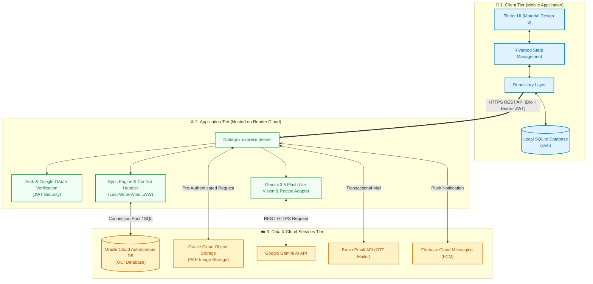
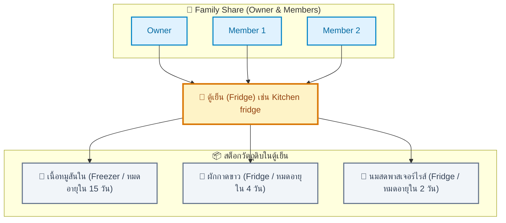
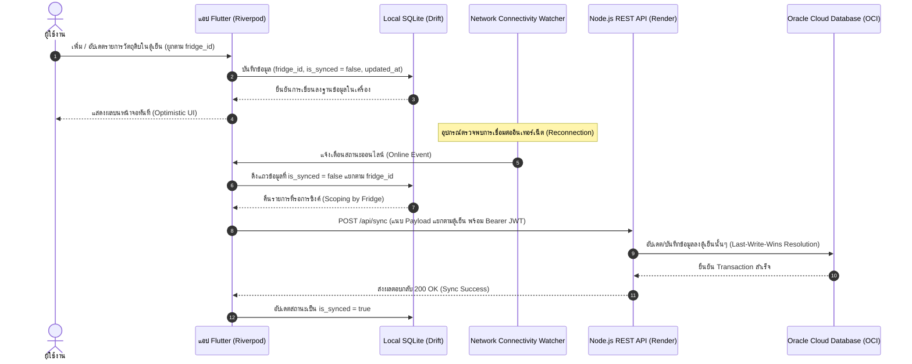
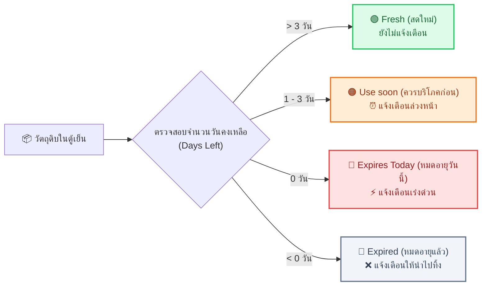
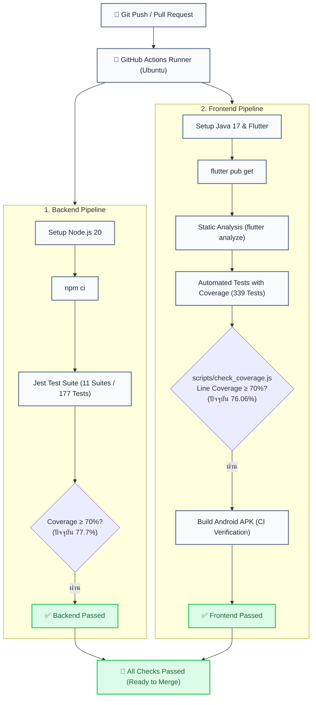

# 🧊 Fridge Management & Expiry Alert App (FM-EAA)

**แอปพลิเคชันจัดการสต็อกวัตถุดิบในตู้เย็นและแจ้งเตือนวันหมดอายุอัจฉริยะ**  
*พัฒนาขึ้นสำหรับโครงงานรายวิชา MDSD-2026*

  
  
  
   
  
  
  
  
   
  
  
  

  แอปพลิเคชันช่วยลดปัญหาขยะอาหาร (Food Waste) และลดค่าใช้จ่ายในบ้านด้วยระบบจัดการสต็อกแบบ <b>Offline-First</b> 
  ใช้งานได้ลื่นไหลแม้ไม่มีอินเทอร์เน็ต พร้อมระบบ <b>Auto-Sync สองทางขึ้น Oracle Cloud</b> และระบบ <b>AI สแกนฉลากหาวันหมดอายุพร้อมคิดเมนูอาหารอัตโนมัติด้วย Google Gemini</b>

---

## 📌 สารบัญ (Table of Contents)

- [💡 ที่มาและความสำคัญ (Problem & Solution)](#-ที่มาและความสำคัญ-problem--solution)
- [✨ ฟีเจอร์เด่นของระบบ (Key Features)](#-ฟีเจอร์เด่นของระบบ-key-features)
- [📱 หน้าจอและดีไซน์ (Screens & Design)](#-หน้าจอและดีไซน์-screens--design)
- [📐 สถาปัตยกรรมระบบและการเชื่อมต่อภายนอก (System Architecture & Integrations)](#-สถาปัตยกรรมระบบและการเชื่อมต่อภายนอก-system-architecture--integrations)
  - [1. สถาปัตยกรรมแบบ 3-Tier (3-Tier Architecture)](#1-สถาปัตยกรรมแบบ-3-tier-3-tier-architecture)
  - [2. โครงสร้างตู้เย็นและ Family Share (Fridge & Family Domain Model)](#2-โครงสร้างตู้เย็นและ-family-share-fridge--family-domain-model)
  - [3. การเชื่อมต่อบริการภายนอก (External Cloud Services)](#3-การเชื่อมต่อบริการภายนอก-external-cloud-services)
- [🔄 ลอจิกการทำงานเชิงเทคนิค (Core Technical Flows)](#-ลอจิกการทำงานเชิงเทคนิค-core-technical-flows)
  - [1. ระบบจัดเก็บข้อมูลแบบ Offline-First (Local SQLite Storage)](#1-ระบบจัดเก็บข้อมูลแบบ-offline-first-local-sqlite-storage)
  - [2. กลไกการซิงค์ข้อมูลอัตโนมัติ (Auto-Synchronization Engine)](#2-กลไกการซิงค์ข้อมูลอัตโนมัติ-auto-synchronization-engine)
  - [3. การวิเคราะห์ภาพถ่ายและเมนูด้วย AI (Gemini Vision & Recipe Generation)](#3-การวิเคราะห์ภาพถ่ายและเมนูด้วย-ai-gemini-vision--recipe-generation)
  - [4. ระบบแจ้งเตือนวันหมดอายุอัจฉริยะ (Expiry Milestones Notification)](#4-ระบบแจ้งเตือนวันหมดอายุอัจฉริยะ-expiry-milestones-notification)
  - [5. ความปลอดภัยและการยืนยันตัวตน (Authentication & Security)](#5-ความปลอดภัยและการยืนยันตัวตน-authentication--security)
- [🌐 สถาปัตยกรรมเส้นทางข้อมูล (REST API Specifications)](#-สถาปัตยกรรมเส้นทางข้อมูล-rest-api-specifications)
- [🛠 เทคโนโลยีที่ใช้ (Tech Stack)](#-เทคโนโลยีที่ใช้-tech-stack)
- [🧪 การทดสอบและระบบ CI/CD (Testing & Quality Gates)](#-การทดสอบและระบบ-cicd-testing--quality-gates)
- [👥 สมาชิกผู้จัดทำ (Contributors)](#-สมาชิกผู้จัดทำ-contributors)

---

## 💡 ที่มาและความสำคัญ (Problem & Solution)

### ปัญหาที่พบ (The Problem)

- **ปัญหาขยะอาหาร (Food Waste)** คนส่วนใหญ่มักลืมของสดที่แช่ไว้ลึกในตู้เย็นจนหมดอายุหรือเน่าเสีย ทำให้ต้องทิ้งอาหารไปโดยเปล่าประโยชน์
- **ซื้อของซ้ำซ้อน** การไม่รู้ว่ามีอะไรอยู่ในตู้เย็นบ้าง ทำให้เผลอซื้อของเดิมมาซ้ำ เสียเงินโดยใช่เหตุ
- **คนในบ้านไม่รู้สต็อกร่วมกัน** สมาชิกในบ้านหรือรูมเมทไม่รู้ว่ามีวัตถุดิบอะไรเหลืออยู่ ชิ้นไหนกินไปแล้ว หรือชิ้นไหนต้องรีบกินก่อนหมดอายุ

### แนวทางการแก้ไข (The Solution)

แอปพลิเคชัน **FM-EAA** ออกแบบมาเพื่อแก้ปัญหาเหล่านี้อย่างครบวงจร ดังนี้

1. **จัดการได้หลายตู้เย็น และแชร์กับครอบครัว (Family Share)** สร้างตู้เย็นได้หลายตู้ (เช่น ตู้เย็นส่วนตัว ตู้เย็นในครัว) และเชิญคนในบ้านเข้ามาดูสต็อกเดียวกัน ให้ทุกคนเห็นข้อมูลตรงกัน
2. **สแกนฉลากด้วย AI (Scan Label with AI)** ถ่ายรูปฉลากอาหาร แล้วใช้ Gemini 3.5 Flash Lite อ่านชื่อและวันหมดอายุลงฟอร์มให้ทันที พร้อมประเมินค่าความเชื่อมั่น (Confidence Score)
3. **ระบบแนะนำเมนูทำอาหารอัจฉริยะ (AI Smart Recipes)** นำวัตถุดิบที่มีอยู่ในตู้เย็นมาคิดเมนูอาหารอัตโนมัติ เพื่อใช้วัตถุดิบให้เกิดประโยชน์สูงสุดก่อนหมดอายุ
4. **ใช้งานแบบ Offline-First** ใช้งานและบันทึกข้อมูลได้ตลอดเวลาแม้ไม่มีเน็ต แล้วค่อยซิงค์ข้อมูลขึ้น Oracle Cloud เมื่อเชื่อมต่อได้
5. **บันทึกประวัติการใช้งาน (History & Audit)** แยกชัดเจนว่าของชิ้นไหนกินแล้ว (Consumed) หรือชิ้นไหนหมดอายุ (Expired) พร้อมระบุว่าใครเป็นคนทำรายการ ช่วยให้วางแผนซื้อของได้ดียิ่งขึ้น

---

## ✨ ฟีเจอร์เด่นของระบบ (Key Features)

### 1. 🥗 การแบ่งหมวดหมู่อาหารและโซนจัดเก็บ (Smart Categorization & Zoning)

- **แยกโซนจัดเก็บชัดเจน (Storage Zones)**
  - ❄️ **Fridge** สำหรับของสด ผัก ผลไม้ และเครื่องดื่ม
  - 🧊 **Freezer** สำหรับอาหารแช่แข็ง เนื้อสัตว์ และของที่เก็บได้นาน
- **หมวดหมู่อาหาร (Categories)**
  - 🌐 **All** แสดงรายการวัตถุดิบทั่วทั้งตู้เย็น
  - 🥩 **Proteins** เนื้อสัตว์ อาหารทะเล ไข่ เต้าหู้
  - 🥦 **Veggies** ผักสด ผลไม้ สมุนไพร
  - 🧃 **Beverages** นม น้ำผลไม้ เครื่องดื่มบรรจุขวด
  - 🍱 **Meals** อาหารปรุงสำเร็จ อาหารพร้อมทาน
  - 🥫 **Sauces** เครื่องปรุงรส ซอส แยม
- **แถบสีบอกสถานะความสดใหม่ (Freshness Visual Cues)**
  - 🟢 **Fresh** วัตถุดิบยังสดใหม่ ปลอดภัย (เหลือมากกว่า 3 วัน)
  - 🟠 **Use soon** ใกล้หมดอายุ ควรรีบนำมารับประทาน (เหลือ 1-3 วัน หรือหมดอายุวันนี้)
  - 🔴 **Expired** หมดอายุแล้ว ไม่ควรนำมารับประทาน

### 2. 🤖 ปัญญาประดิษฐ์สแกนฉลากและแนะนำสูตรอาหาร (Gemini AI Vision & Recipes)

- **AI Label Scanner** ถ่ายภาพฉลากอาหาร สกัดชื่อสินค้าและวันหมดอายุลงฟอร์มทันที พร้อมระบบ **Confidence Guard** ตรวจสอบคุณภาพภาพถ่าย หากภาพเบลอหรือมุมโค้งจะแจ้งเตือนให้ผู้ใช้ตรวจทานเพื่อความปลอดภัย
- **Smart Fallback Engine** หากโควตา API หรือสัญญาณอินเทอร์เน็ตขัดข้อง มีระบบ Local Rule-based Generator ช่วยประเมินอายุการเก็บรักษาและสูตรอาหารสำรองให้อัตโนมัติ

### 3. 🔍 ระบบค้นหาวัตถุดิบ (Search & Filters)

- ค้นหาของในตู้เย็นได้ทันทีผ่านช่องค้นหาเดียว ไม่ว่าจะอยู่ใน Fridge หรือ Freezer
- กรองตามชื่อ หมวดหมู่ และโซนจัดเก็บได้รวดเร็วผ่าน Index ของฐานข้อมูล Drift SQLite ในเครื่อง

### 4. ✅ การบันทึกการบริโภคและประวัติการใช้งาน (Mark as Consumed & History)

- **Mark as Consumed** เลือกจำนวนที่บริโภคได้ ("How much did you consume?") หรือกด **Finished all** เมื่อกินหมด และกด **Undo** เพื่อย้อนกลับได้ทันที
- **ประวัติการใช้งาน (History)** แยกเป็น 2 แท็บ
  - 🍽️ **Consumed** ของที่นำไปทำอาหารหรือกินแล้ว
  - ⏰ **Expired** ของที่เลยวันหมดอายุ เพื่อใช้ดูสถิติลดขยะอาหาร
- แสดงชื่อผู้ทำรายการและเวลาชัดเจน (เช่น `by @sarah`) ลบอัตโนมัติเมื่อครบ 30 วัน หรือกด **Clear All** ได้

### 5. 👨‍👩‍👧‍👦 การจัดการตู้เย็นและสมาชิก (My Fridges & Family Share)

- **My Fridges** สร้าง แก้ไข และลบตู้เย็นได้หลายตู้ โดยแต่ละตู้มีชื่อ คำอธิบาย และสมาชิกของตัวเอง
- **Family Share** กำหนดสิทธิ์บทบาท **Owner** และ **Member** เพื่อแชร์สต็อกวัตถุดิบร่วมกันในครอบครัว
- **Invite Member** ค้นหาผู้ใช้ด้วย Username และส่งคำเชิญ โดยผู้รับต้องกดยืนยัน (Accept / Decline) ก่อนเข้าร่วมตู้เย็น
- **Isolate Fridge Notifications** ระบบแจ้งเตือนแยกตามตู้เย็นอย่างเด็ดขาด พร้อม Badge แสดงจำนวนของใกล้หมดอายุบนแถบหัวตู้เย็น

### 6. ⚙️ การตั้งค่าและระบบสองภาษา (Settings & Localization)

- แก้ไขโปรไฟล์ (Edit Profile) และเปลี่ยนรหัสผ่าน พร้อมการตรวจเช็กความปลอดภัย
- สลับภาษา **ไทย (TH) / อังกฤษ (EN)** ได้สมบูรณ์ทั้งแอป โดยคงชื่ออาหารเดิมไว้ไม่ให้เพี้ยน
- สลับธีม **Light / Dark Mode** ตามความชอบ

---

## 📱 หน้าจอและดีไซน์ (Screens & Design)

การออกแบบส่วนต่อประสานผู้ใช้ (UI) และประสบการณ์ผู้ใช้ (UX) ของแอปพลิเคชัน FM-EAA ได้รับการออกแบบบน Figma ตามแนวทาง **Material Design 3 (M3)** เน้นความเรียบง่าย สบายตา ใช้งานมือเดียวได้สะดวก และรองรับการแสดงผลแบบ Responsive

- 🎨 **Figma Prototype & Design** [FM-EAA on Figma](https://www.figma.com/design/MB6XUkZz1GZqJpDqvfkHYc/FM-EAA?node-id=0-1&t=dJwjYD0ae67KEzdu-1)
- 📋 **Design Specification** รายละเอียดหน้าจอ โทเคนสี และ Flow ฉบับเต็ม ดูได้ที่ [docs/DESIGN_SPEC.md](docs/DESIGN_SPEC.md)

### ตารางสรุปกลุ่มหน้าจอหลักของระบบ

| กลุ่มหน้าจอ (Category) | หน้าจอหลักในระบบ | รายละเอียดและฟังก์ชันสำคัญ |
| :--- | :--- | :--- |
| **1. Auth & Onboarding** | Onboarding & Permission, Sign In, Create an Account, Reset Password | หน้าแนะนำลดขยะอาหารและขอสิทธิ์แจ้งเตือน, เข้าสู่ระบบด้วย Email/Username หรือ Google, สมัครสมาชิกพร้อมตรวจสอบรหัสผ่าน 8 ตัวขึ้นไป และขอรีเซ็ตรหัสผ่านทางอีเมล |
| **2. ตู้เย็น (Fridges)** | My Fridges, Add New Fridge, Edit Fridge, Delete Fridge Dialog | แสดงรายการตู้เย็นแบบ Grid Card, สรุปจำนวนของที่ต้องรีบกินวันนี้, สร้างตู้ใหม่, แก้ไขชื่อ/คำอธิบาย และลบตู้เย็น |
| **3. ภายในตู้ (Fridge Detail)** | Fridge Detail (Fridge / Freezer tabs), Search | สลับดูโซนช่องธรรมดาและช่องแช่แข็ง, แถบชิปกรองหมวดหมู่, ค้นหาวัตถุดิบคีย์เวิร์ดพร้อมล้างคำค้นหา |
| **4. วัตถุดิบ (Item Management)** | Add Items, Item Details, Edit Item Details, Mark as Consumed, Finish All, Delete Item Dialog | สแกนฉลากด้วย Gemini Vision API เติมฟอร์มอัตโนมัติ, แสดงรายละเอียดวัตถุดิบและป้ายเตือนความสด, บันทึกการกินระบุจำนวนหรือกินหมด (พร้อมปุ่ม Undo) |
| **5. เมนูอาหาร (Recipes)** | Recipe Suggestions Page | แนะนำเมนูอาหารอัตโนมัติจากของที่มีในตู้เย็น พร้อมขั้นตอนการทำและระดับความยากง่าย |
| **6. ประวัติ (History)** | History (Consumed & Expired tabs) | ประวัติแยก 2 แท็บ (กินแล้ว / หมดอายุ), ระบุผู้ทำรายการและเวลา, ลบอัตโนมัติ 30 วัน หรือกด Clear All |
| **7. ครอบครัว (Family Share)** | Family Share, Invite to Family, Remove Member Dialog | จัดการสมาชิกในตู้เย็น (Owner / Member), ค้นหาสมาชิกด้วย Username เพื่อส่งคำเชิญ และลบสมาชิก |
| **8. ตั้งค่าและการแจ้งเตือน (Settings & Notifications)** | Notifications, Settings, Edit Profile, Log Out Dialog | ศูนย์รวมการแจ้งเตือน (เตือนวันหมดอายุ และรับ/ปฏิเสธคำเชิญเข้าตู้), แก้ไขโปรไฟล์และเปลี่ยนรหัสผ่าน, สลับภาษา TH/EN, สลับธีม Light/Dark และออกจากระบบ |

---

## 📐 สถาปัตยกรรมระบบและการเชื่อมต่อภายนอก (System Architecture & Integrations)

### 1. สถาปัตยกรรมแบบ 3-Tier (3-Tier Architecture)

โครงสร้างระบบแบ่งการทำงานออกเป็น 3 ส่วน (3-Tier Architecture) เพื่อให้จัดการโค้ดง่าย ปลอดภัย และดูแลระบบได้สะดวก

---

### 2. โครงสร้างตู้เย็นและ Family Share (Fridge & Family Domain Model)

---

### 3. การเชื่อมต่อบริการภายนอก (External Cloud Services)

ระบบหลังบ้านมีการเชื่อมโยงบริการคลาวด์มาตรฐานระดับ Enterprise โดยแยก Config และ Secrets ผ่าน Environment Variables อย่างปลอดภัย ดังรายการในตาราง

| บริการคลาวด์ | เทคโนโลยี / ผู้ให้บริการ | บทบาทและหน้าที่การทำงาน |
| :--- | :--- | :--- |
| **Backend PaaS** | [Render Cloud](https://render.com) | โฮสต์และรัน Node.js REST API ตลอด 24 ชม. พร้อมระบบรักษาความปลอดภัย HTTPS และ Auto-Deploy |
| **Enterprise Database** | [Oracle Cloud Infrastructure (OCI)](https://cloud.oracle.com) | ฐานข้อมูลหลัก (Autonomous Database) จัดเก็บข้อมูลผู้ใช้ ตู้เย็น สต็อกอาหาร และประวัติกิจกรรม |
| **Object Storage** | [OCI Object Storage](https://cloud.oracle.com/storage) | จัดเก็บไฟล์รูปภาพอาหารและรูปโปรไฟล์ผู้ใช้งาน ผ่าน Pre-Authenticated Request (PAR) |
| **Artificial Intelligence** | [Google Gemini 3.5 Flash Lite](https://ai.google.dev) | สแกนภาพฉลากอาหาร สกัดชื่อและวันหมดอายุ (OCR Vision) พร้อมวิเคราะห์และแนะนำเมนูอาหาร |
| **Transactional Email** | [Brevo (Sendinblue)](https://www.brevo.com) | ส่งอีเมลรหัสยืนยัน OTP และลิงก์สำหรับรีเซ็ตรหัสผ่าน (Forgot Password) |
| **Push Notification** | [Firebase Cloud Messaging (FCM)](https://firebase.google.com) | ส่งการแจ้งเตือนอาหารใกล้หมดอายุและคำเชิญตู้เย็นเข้าสู่สมาร์ตโฟนของผู้ใช้ |
| **Identity Provider** | [Google Identity Services](https://developers.google.com/identity) | ยืนยันตัวตนด้วย Google OAuth 2.0 ฝั่งเซิร์ฟเวอร์ด้วย Google ID Token |

---

## 🔄 ลอจิกการทำงานเชิงเทคนิค (Core Technical Flows)

### 1. ระบบจัดเก็บข้อมูลแบบ Offline-First (Local SQLite Storage)

- ข้อมูลทั้งหมดจะถูกเขียนและอ่านจาก SQLite ในเครื่อง (ผ่าน Drift) เป็นหลัก
- **Optimistic UI** เมื่อผู้ใช้เพิ่ม ลบ หรือแก้ไขรายการอาหาร หน้าจอจะอัปเดตผลทันทีผ่าน Riverpod โดยไม่ต้องรอเซิร์ฟเวอร์ตอบกลับ
- ระบบจะกำหนดสถานะ `is_synced = false` พร้อมบันทึก Timestamp ล่าสุดไว้ในเครื่อง เพื่อเตรียมส่งข้อมูลเมื่อเชื่อมต่อเน็ตได้

---

### 2. กลไกการซิงค์ข้อมูลอัตโนมัติ (Auto-Synchronization Engine)

- มีตัวตรวจสอบสถานะอินเทอร์เน็ตทำงานอยู่เบื้องหลัง
- เมื่ออุปกรณ์กลับมาเชื่อมต่อเน็ตได้ (Offline ➔ Online)
  1. ดึงข้อมูลที่ยังไม่ได้ซิงค์ (`is_synced = false`) ทั้งหมดจาก Drift ในเครื่อง
  2. รวมข้อมูลแล้วส่งคำขอแบบชุด (Batched Sync) ไปยัง Node.js API (`POST /api/sync`)
  3. เซิร์ฟเวอร์ตรวจสอบและบันทึกลง Oracle Cloud Database (OCI) โดยใช้หลัก **Last-Write-Wins (LWW)** เพื่อจัดการกรณีข้อมูลชนกัน
  4. เมื่อเซิร์ฟเวอร์บันทึกสำเร็จ แอปจะปรับสถานะเป็น `is_synced = true` และตั้งเวลาแจ้งเตือนวันหมดอายุรอบใหม่

---

### 3. การวิเคราะห์ภาพถ่ายและเมนูด้วย AI (Gemini Vision & Recipe Generation)

- ผู้ใช้กด **Scan Label with AI** แล้วถ่ายภาพฉลากอาหาร
- แอปส่งรูปภาพผ่าน API ไปยัง **Google Gemini Vision API**
- ระบบ AI ช่วยอ่านข้อความสำคัญบนฉลาก
  - **ชื่ออาหาร (Food Name)** สกัดชื่อสินค้าหรือชนิดวัตถุดิบ
  - **วันหมดอายุ (Expiration Date)** อ่านวันที่จากข้อความบนฉลาก เช่น EXP, BBD หรือ ควรบริโภคก่อน
  - **ความเชื่อมั่น (Confidence Score)** หากคะแนนต่ำกว่า 0.7 ระบบจะแสดงแถบเตือนสีเหลืองให้ผู้ใช้ช่วยตรวจทานชื่ออาหาร
- **Auto-fill & Review** นำข้อมูลที่อ่านได้มากรอกลงแบบฟอร์มให้อัตโนมัติ เพื่อให้ผู้ใช้ตรวจทานและแก้ไขก่อนกด **Save**
- **Recipe Generation** วิเคราะห์วัตถุดิบที่มีในตู้เย็นแล้วส่งคำขอเพื่อรับสูตรอาหารพร้อมวิธีปรุงอย่างละเอียด

---

### 4. ระบบแจ้งเตือนวันหมดอายุอัจฉริยะ (Expiry Milestones Notification)

ระบบจัดหมวดหมู่การแจ้งเตือนวันหมดอายุออกเป็น 3 หมุดหมายสำคัญ (Milestones) เพื่อความชัดเจนและป้องกันการแจ้งเตือนซ้ำซาก (Anti-Spam) ดังนี้

- **ระดับที่ 1 Use soon (เหลือ 1-3 วัน)** แจ้งเตือนล่วงหน้าเพื่อให้วางแผนนำมาประกอบอาหาร
- **ระดับที่ 2 Expires Today (เหลือ 0 วัน)** แจ้งเตือนวันหมดอายุตรงตามรอบวัน (D-Day)
- **ระดับที่ 3 Expired (เลยวันหมดอายุมา 1 วัน)** แจ้งเตือนให้ตรวจสอบและนำไปทิ้ง
- **One-Time Milestone Guard** อาหารแต่ละรายการจะส่ง Notification เพียง 1 ครั้งต่อหมุดหมายเท่านั้น หากหมดอายุเกิน 1 วันไปแล้วจะไม่ส่งสแปมซ้ำซ้อน แต่จะแสดงเป็นป้ายสีแดงบนหน้าตู้เย็นแทน

---

### 5. ความปลอดภัยและการยืนยันตัวตน (Authentication & Security)

- **การเข้าสู่ระบบ 2 รูปแบบ**
  - **Username / Email + Password** สมัครสมาชิกด้วย Username, Email และรหัสผ่านอย่างน้อย 8 ตัวอักษร
  - **Google OAuth 2.0** เข้าสู่ระบบผ่าน Google Sign-In SDK บนมือถือ
- **การรีเซ็ตรหัสผ่าน (Forgot password)** กรอกอีเมลเพื่อรับรหัส OTP 6 หลักผ่าน Brevo Email Service
- **การตรวจสอบฝั่งเซิร์ฟเวอร์** แอปส่ง Google ID Token ไปยัง Node.js API เพื่อตรวจสอบความถูกต้องกับ Google API ก่อนออก JWT
- **การปกป้อง API ด้วย JWT** เซิร์ฟเวอร์ออก JSON Web Token (JWT) ให้แอปเก็บไว้ใน `FlutterSecureStorage` (เข้ารหัสระดับ Hardware Keystore/Keychain) และแนบไปกับ Header `Authorization Bearer <Token>` ทุกคำขอ

---

## 🌐 สถาปัตยกรรมเส้นทางข้อมูล (REST API Specifications)

ระบบฝั่งเซิร์ฟเวอร์ออกแบบตามสถาปัตยกรรม RESTful แบ่งออกเป็น **9 กลุ่มโมดูลหลัก** อย่างเป็นระบบ ดังนี้

| กลุ่มโมดูล (Module) | ตัวอย่าง Endpoints สำคัญ | หน้าที่การทำงาน |
| :--- | :--- | :--- |
| **1. Authentication** | `POST /api/auth/register` `POST /api/auth/login` `POST /api/auth/google` `POST /api/auth/forgot-password` | สมัครสมาชิก เข้าสู่ระบบด้วยรหัสผ่านหรือ Google OAuth ขอ OTP และรีเซ็ตรหัสผ่าน |
| **2. User Profile** | `GET /api/users/me` `PATCH /api/users/me` `POST /api/users/me/avatar` `POST /api/users/fcm-token` | จัดการข้อมูลส่วนตัว อัปโหลดรูปโปรไฟล์ ค้นหาผู้ใช้ และลงทะเบียน Device Token |
| **3. Fridges** | `GET /api/fridges` `POST /api/fridges` `PATCH /api/fridges/{id}` `DELETE /api/fridges/{id}` | จัดการรายการตู้เย็น สร้าง แก้ไข ลบตู้เย็น และจัดการสมาชิกในตู้เย็น |
| **4. Invitations** | `POST /api/fridges/{id}/invites` `GET /api/invites/pending` `POST /api/invites/{id}/accept` `POST /api/invites/{id}/decline` | ส่งคำเชิญเข้าร่วมตู้เย็น ตรวจสอบคำเชิญค้างรับ กดยอมรับหรือปฏิเสธคำเชิญ |
| **5. Items & Inventory** | `GET /api/fridges/{id}/items` `POST /api/fridges/{id}/items` `PATCH /api/items/{itemId}` `POST /api/items/{itemId}/consume` `POST /api/items/history/{historyId}/undo` | จัดการสต็อกวัตถุดิบ ตัดยอดการกิน (บางส่วน/กินหมด) ยกเลิกการตัดสต็อก และอัปโหลดภาพอาหาร |
| **6. History & Audit** | `GET /api/fridges/{id}/history` `DELETE /api/fridges/{id}/history/clear` `DELETE /api/fridges/{id}/history/{historyId}` | ดึงประวัติการกินและการหมดอายุย้อนหลัง ล้างประวัติ หรือลบรายการเฉพาะจุด |
| **7. Notifications** | `GET /api/notifications` `GET /api/notifications/unread-count` `POST /api/notifications/check-expiry` `PATCH /api/notifications/read-all` | ศูนย์รวมการแจ้งเตือน ตรวจสอบอาหารหมดอายุ ทำเครื่องหมายว่าอ่านแล้ว และลบข้อความ |
| **8. AI Engine** | `POST /api/ai/scan-label` `POST /api/ai/recipes` `GET /api/ai/recipes/quota` | ส่งภาพฉลากให้ Gemini วิเคราะห์ OCR วันหมดอายุ และขอสูตรอาหารจากวัตถุดิบในตู้ |
| **9. Sync Engine** | `POST /api/sync` | รองรับการซิงค์ข้อมูลแบบสองทาง (Batched Two-Way Sync) ด้วยหลัก Last-Write-Wins |

---

## 🛠 เทคโนโลยีที่ใช้ (Tech Stack)

| ส่วนของระบบ | เทคโนโลยีที่เลือกใช้ | บทบาทและหน้าที่การทำงาน |
| :--- | :--- | :--- |
| **Mobile Client** | [Flutter 3.x](https://flutter.dev) (Dart) | พัฒนาแอปพลิเคชันสำหรับ iOS และ Android แบบ Cross-Platform |
| **State Management** | [Riverpod](https://riverpod.dev) | จัดการสถานะแอปพลิเคชันแบบ Reactive และแยก Business Logic ออกจาก UI |
| **Local Database** | [Drift (SQLite)](https://drift.simonbinder.eu/) | ฐานข้อมูล SQLite ในเครื่อง รองรับการใช้งานแบบ Offline-First ทำงานร่วมกับ Riverpod แบบ Stream |
| **HTTP Client** | [Dio](https://pub.dev/packages/dio) | จัดการคำขอ HTTP Request/Response พร้อมระบบ Interceptors ดักจับข้อผิดพลาดและแนบ JWT |
| **Secure Storage** | [Flutter Secure Storage](https://pub.dev/packages/flutter_secure_storage) | จัดเก็บ JWT Token ในระดับ Hardware Keychain (iOS) และ Keystore (Android) |
| **Backend Framework** | [Node.js](https://nodejs.org) (Express 4.x) | REST API สำหรับประมวลผลคำขอ จัดการข้อมูล และเชื่อมต่อฐานข้อมูล |
| **Application Hosting** | [Render Cloud](https://render.com) | โฮสต์เซิร์ฟเวอร์ Node.js API พร้อมระบบ HTTPS และ CI/CD Deploy อัตโนมัติ |
| **Cloud Database** | [Oracle Cloud Infrastructure (OCI)](https://cloud.oracle.com) | ฐานข้อมูล Autonomous Database จัดเก็บข้อมูลหลักทั้งหมดของระบบ |
| **Object Storage** | [OCI Object Storage](https://cloud.oracle.com/storage) | จัดเก็บไฟล์รูปภาพอาหารและโปรไฟล์ผ่าน Pre-Authenticated Request (PAR) |
| **AI Vision Engine** | [Google Gemini 3.5 Flash Lite](https://ai.google.dev) | โมเดลปัญญาประดิษฐ์อ่านภาพฉลาก สกัดชื่ออาหาร วันหมดอายุ และแนะนำสูตรอาหาร |
| **Email Service** | [Brevo API](https://www.brevo.com) | ระบบส่งอีเมลแจ้งเตือนรหัส OTP สำหรับรีเซ็ตรหัสผ่าน |
| **Push Notification** | [Firebase Cloud Messaging](https://firebase.google.com) | บริการยิง Push Notification แจ้งเตือนอาหารใกล้หมดอายุเข้ามือถือ |

---

## 🧪 การทดสอบและระบบ CI/CD (Testing & Quality Gates)

ทีมงานใช้ **GitHub Actions** เป็นระบบ CI/CD Pipeline อัตโนมัติเพื่อควบคุมคุณภาพของซอฟต์แวร์อย่างเข้มงวดในทุก Pull Request ก่อนจะรวมโค้ดเข้าสู่ `develop` และ `main` ดังกระบวนการต่อไปนี้

### 📊 สรุปผลการทดสอบ (Test Results & Coverage Summary)

| ส่วนงาน (Component) | สถิติการทดสอบ | Code Coverage ที่ทำได้ | เกณฑ์ขั้นต่ำ (Quality Gate) | สถานะ |
| :--- | :---: | :---: | :---: | :---: |
| **Frontend (Flutter)** | ผ่านครบ **339 / 339 Tests** (100%) | **`76.06%`** (7,497 / 9,857 บรรทัด) | $\ge 70.0\%$ | ✅ **PASSED** |
| **Backend (Node.js)** | ผ่านครบ **177 / 177 Tests** (100%) | **`77.70%`** Statements / **`78.24%`** Lines | $\ge 70.0\%$ | ✅ **PASSED** |
| **รวมทั้งระบบ (Total)** | **516 / 516 Tests ผ่านครบถ้วน 100%** | **$\ge 76.0\%$ ทั้งฝั่งหน้าบ้านและหลังบ้าน** | $\ge 70.0\%$ | 🏆 **EXCEEDED** |

- **Static Analysis** รัน `flutter analyze` ตรวจสอบทั้งโปรเจกต์ **0 issues found** สะอาดหมดจด
- **Quality Gates** ใช้สคริปต์ `scripts/check_coverage.js` กรองไฟล์ Auto-generated (`.g.dart`) ออก และตรวจสอบค่า Line Coverage จาก `lcov.info` จริงบน Ubuntu Runner หากต่ำกว่า 70% ระบบจะไม่อนุญาตให้รวมโค้ด
- **Automated Build** ผ่านการคอมไพล์และสร้างไฟล์ติดตั้ง Android (`app-release.apk`) สำเร็จสมบูรณ์

---

## 👥 สมาชิกผู้จัดทำ (Contributors)

โครงงานนี้เป็นส่วนหนึ่งของการศึกษารายวิชา **MDSD-2026** จัดทำโดยคณะผู้จัดทำ ดังรายนามต่อไปนี้

- **นางสาวอาทิตยา ผิวขำ** (รหัสนักศึกษา 67030260)
- **นายชนินทร์ คำวงศ์ษา** (รหัสนักศึกษา 67030281)
- **นายธนบดี บุญภมร** (รหัสนักศึกษา 67030298)
- **นายธีธัช รัตนโสภา** (รหัสนักศึกษา 67030302)
