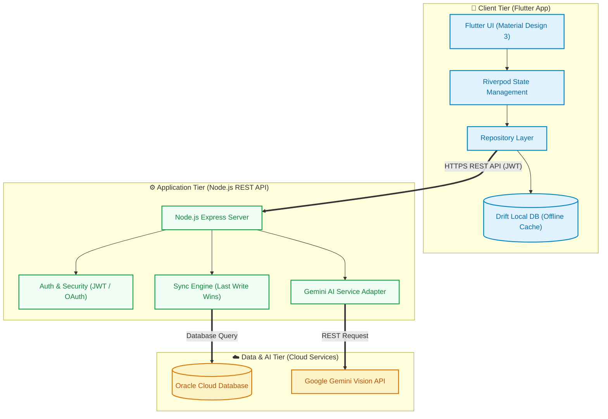
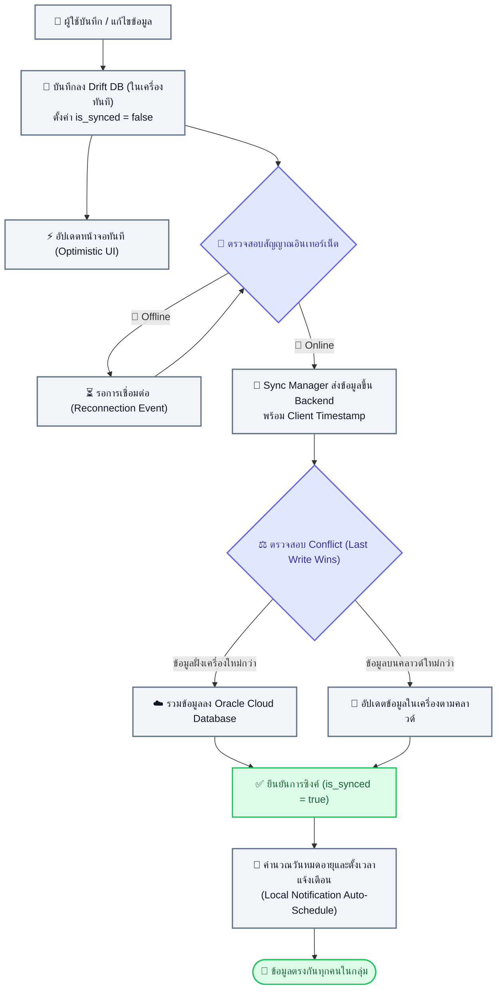
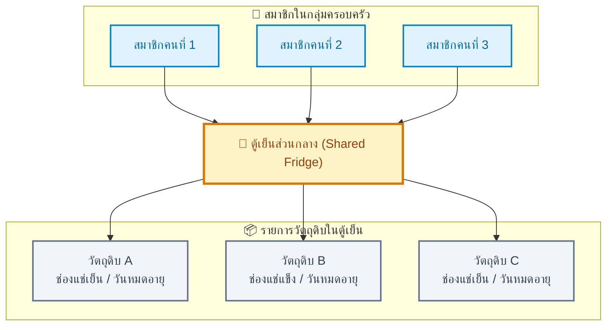
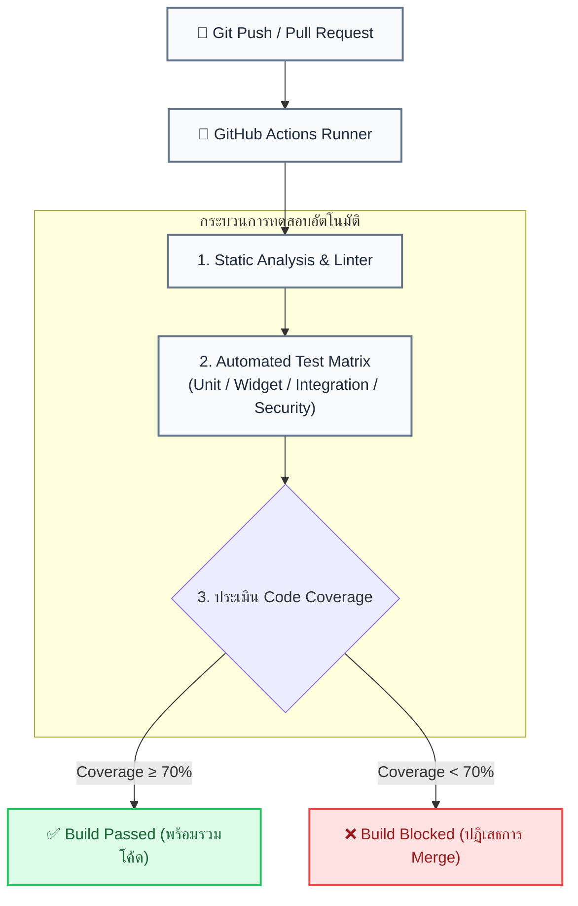

<div align="center">

# 🧊 Fridge Management & Expiry Alert App (FM-EAA)
**แอปพลิเคชันจัดการของในตู้เย็นและแจ้งเตือนวันหมดอายุอัจฉริยะ**

[](https://flutter.dev)
[](https://nodejs.org)
[](https://www.oracle.com/database/)
[](https://drift.simonbinder.eu/)
[](https://ai.google.dev/)
[](https://github.com/features/actions)
[](#-การทดสอบและ-cicd-testing--automation)

<p align="center">
  มุ่งเน้นลดปัญหาขยะอาหาร (Food Waste) และลดค่าใช้จ่ายในครัวเรือนด้วยระบบจัดการสต็อกวัตถุดิบส่วนกลาง พร้อมกลไก Offline-First และพลังวิเคราะห์จาก Multimodal AI
</p>

---

</div>

## 📌 สารบัญ (Table of Contents)
- [💡 ปัญหาและแนวทางการแก้ไข (Problem & Solution)](#-ปัญหาและแนวทางการแก้ไข-problem--solution)
- [✨ ฟีเจอร์หลัก (Key Features)](#-ฟีเจอร์หลัก-key-features)
- [📐 โครงสร้างสถาปัตยกรรม (System Architecture)](#-โครงสร้างสถาปัตยกรรม-system-architecture)
  - [1. 3-Tier Architecture Overview](#1-3-tier-architecture-overview)
  - [2. Offline-First & Data Sync Engine](#2-offline-first--data-sync-engine)
  - [3. Shared Fridge Domain Model](#3-shared-fridge-domain-model)
- [🛠 เทคโนโลยีที่ใช้ (Tech Stack)](#-เทคโนโลยีที่ใช้-tech-stack)
- [🧪 การทดสอบและ CI/CD (Testing & Automation)](#-การทดสอบและ-cicd-testing--automation)
- [🎨 การออกแบบ UI/UX (Design Principles)](#-การออกแบบ-uiux-design-principles)
- [🚀 วิธีการติดตั้งและรันโปรเจกต์ (Getting Started)](#-วิธีการติดตั้งและรันโปรเจกต์-getting-started)
- [👥 สมาชิกผู้จัดทำ (Contributors)](#-สมาชิกผู้จัดทำ-contributors)

---

## 💡 ปัญหาและแนวทางการแก้ไข (Problem & Solution)

### ปัญหาที่พบ (The Problem)
* **วิกฤตขยะอาหาร (Food Waste)** ผู้บริโภคมักหลงลืมของสดและวัตถุดิบที่แช่ไว้ลึกในตู้เย็นจนเกินวันหมดอายุ ส่งผลให้เกิดปริมาณขยะอาหารสะสมและกระทบต่อสิ่งแวดล้อม
* **ค่าใช้จ่ายครัวเรือนสิ้นเปลือง** การขาดมุมมองภาพรวมสต็อกของสดในบ้าน มักนำไปสู่พฤติกรรมการซื้อวัตถุดิบซ้ำซ้อนโดยไม่จำเป็น
* **ข้อจำกัดในการแชร์ข้อมูลร่วมกัน** สำหรับกลุ่มครอบครัวหรือรูมเมทในหอพักและคอนโด สมาชิกมักสื่อสารสถานะของสดไม่ทั่วถึง ทำให้ไม่ทราบว่าของชิ้นใดกำลังจะเสียหรือถูกนำไปประกอบอาหารแล้ว

### แนวทางการแก้ไข (The Solution)
**FM-EAA** ออกแบบมาเพื่อยกระดับการจัดการตู้เย็นอย่างเป็นรูปธรรม ผ่าน 3 เสาหลักสำคัญ
1. **Shared Ecosystem** ปรับรูปแบบการถือครองข้อมูลให้ผูกกับ "ตู้เย็นส่วนกลาง" แทนตัวบุคคล ทำให้สมาชิกทุกคนในบ้านเห็นและอัปเดตสต็อกตรงกันแบบเรียลไทม์
2. **Zero-Friction Logging** ลดภาระการบันทึกด้วย Gemini Vision API ที่ช่วยวิเคราะห์ภาพฉลากและสกัดวันหมดอายุเพื่อเติมลงฟอร์มอัตโนมัติในไม่กี่วินาที
3. **Proactive Alerting & Waste Reduction** ควบคุมการแจ้งเตือนวันหมดอายุล่วงหน้าตรงถึงมือถือแบบออฟไลน์ พร้อมระบบ AI ช่วยสร้างสรรค์เมนูจากของที่ต้องรีบใช้เพื่อเคลียร์ตู้เย็นอย่างคุ้มค่า

---

## ✨ ฟีเจอร์หลัก (Key Features)

| หมวดหมู่งาน | รายละเอียดความสามารถของระบบ |
| :--- | :--- |
| 👨‍👩‍👧‍👦 **Family Group (Shared Fridge)** | สถาปัตยกรรมตู้เย็นรวม โดยข้อมูลวัตถุดิบจะผูกกับตู้เย็นส่วนกลางโดยตรง สมาชิกทุกคนในกลุ่มจึงสามารถตรวจสอบ เพิ่ม ลบ หรืออัปเดตข้อมูลของสดร่วมกันได้อย่างแม่นยำ |
| 🔄 **Offline-First & Auto Data Sync** | มุ่งเน้นความต่อเนื่องในการใช้งานผ่านการเก็บข้อมูลลงฐานข้อมูลในเครื่อง (Local DB) ทำให้เปิดดูและเพิ่มรายการได้ทันทีแม้ไม่มีสัญญาณอินเทอร์เน็ต พร้อมระบบ Auto-Sync ขึ้นคลาวด์อัตโนมัติเมื่อออนไลน์ด้วยกลยุทธ์ Last Write Wins (LWW) |
| 🔔 **Offline Local Notification & Auto-Schedule** | แจ้งเตือนวันหมดอายุล่วงหน้าบนอุปกรณ์ได้โดยไม่ต้องพึ่งพาสัญญาณอินเทอร์เน็ต ระบบจะคำนวณวันหมดอายุและตั้งเวลาแจ้งเตือนให้สมาชิกทุกคนในกลุ่มครอบครัวอัตโนมัติเมื่อมีการซิงค์ข้อมูลใหม่ |
| 👁️ **AI Vision OCR (Gemini API)** | สแกนภาพถ่ายฉลากอาหารเพื่อแยกแยะชื่อวัตถุดิบ หมวดหมู่ และวันหมดอายุ Auto-fill ลงในฟอร์ม พร้อมวางกระบวนการแบบ Human-in-the-loop เพื่อเปิดโอกาสให้ผู้ใช้งานได้ตรวจทานและแก้ไขก่อนกดยืนยันบันทึกเสมอ |
| 🍳 **AI Recipe Generator (Gemini API)** | ตรวจสอบรายการวัตถุดิบที่อยู่ในเกณฑ์ใกล้หมดอายุ แล้วนำมาประมวลผลแนะนำสูตรอาหารพร้อมวิธีปรุงอย่างละเอียด ช่วยลดปัญหาขยะอาหารอย่างมีประสิทธิภาพ |
| 📦 **Smart Inventory & Zoning** | จัดการสต็อกวัตถุดิบ วันที่ซื้อ วันหมดอายุ พร้อมแยกโซนจัดเก็บอย่างชัดเจนระหว่างช่องแช่เย็นธรรมดา (Chiller) และช่องแช่แข็ง (Freezer) เพื่อให้ได้การประเมินอายุการเก็บรักษาที่ตรงตามจริง |
| 🚦 **Visual Cue (Freshness Indicator)** | สื่อสารสถานะความสดใหม่ผ่านโค้ดสีตามหลัก UI/UX<br>🟢 **สีเขียว** ปลอดภัย อยู่ในเกณฑ์สดใหม่<br>🟡 **สีเหลือง** ใกล้หมดอายุ ควรเร่งนำมาบริโภค<br>🔴 **สีแดง** หมดอายุแล้ว ไม่แนะนำให้นำมารับประทาน |
| 🔐 **Multi-Identity Authentication** | รองรับการยืนยันตัวตนทั้งรูปแบบ Email/Password (JWT) และ OAuth 2.0 ร่วมกับ Google พร้อมความยืดหยุ่นในการเชื่อมต่อ (Link) หรือยกเลิกการเชื่อมต่อ (Unlink) บัญชีได้ตลอดเวลาในหน้าตั้งค่า |

---

## 📐 โครงสร้างสถาปัตยกรรม (System Architecture)

### 1. 3-Tier Architecture Overview
โครงสร้างระบบถูกแบ่งออกเป็น 3 ระดับชั้น เพื่อความเป็นสัดส่วนในการจัดการความปลอดภัย และความง่ายต่อการขยายระบบในอนาคต



---

### 2. Offline-First & Data Sync Engine
ระบบให้ความสำคัญสูงสุดกับความพร้อมใช้งาน (High Availability) และความเร็วในการตอบสนอง โดยจำลองลำดับขั้นตอนการทำงานไว้ดังนี้



---

### 3. Shared Fridge Domain Model
โครงสร้างการออกแบบเชิงข้อมูลที่รวมศูนย์สต็อกไว้ที่ระดับกลุ่มครอบครัว



---

## 🛠 เทคโนโลยีที่ใช้ (Tech Stack)

### ฝั่งหน้าบ้าน (Mobile Application)
* **Framework** [Flutter](https://flutter.dev) สำหรับพัฒนาแอปพลิเคชันแบบ Cross-platform
* **State Management** [Riverpod](https://riverpod.dev) จัดการสถานะแอปพลิเคชันแบบ Reactive และแยก Business Logic ออกจาก UI อย่างชัดเจน
* **Local Persistence** [Drift](https://drift.simonbinder.eu/) ฐานข้อมูล SQLite แบบ Type-safe สำหรับรองรับสถาปัตยกรรม Offline-First
* **Local Notifications** `flutter_local_notifications` บริหารคิวการแจ้งเตือนแบบ Scheduled Alert ภายในอุปกรณ์

### ฝั่งหลังบ้าน (Application Server)
* **Runtime** [Node.js](https://nodejs.org) รันบนสภาพแวดล้อม JavaScript ฝั่งเซิร์ฟเวอร์
* **Architecture** RESTful API Architecture
* **Security & Auth** มาตรฐาน JSON Web Tokens (JWT), Handshake ร่วมกับ OAuth 2.0, เข้ารหัสรหัสผ่านด้วย bcrypt พร้อมเปิดใช้งาน Helmet และกำหนดสิทธิ์ CORS อย่างรัดกุม

### ฐานข้อมูลและบริการเสริม (Database & Cloud Services)
* **Remote Database** [Oracle Cloud Database](https://www.oracle.com/database/) จัดเก็บข้อมูลความสัมพันธ์ แอกเคานต์ผู้ใช้ และข้อมูลกลุ่มครอบครัว
* **AI Engine** [Google Gemini Vision API](https://ai.google.dev/) ขับเคลื่อนระบบ Multimodal OCR และสร้างสรรค์เมนูอาหาร

---

## 🧪 การทดสอบและ CI/CD (Testing & Automation)

เพื่อให้ผลงานเป็นไปตามมาตรฐานวิศวกรรมซอฟต์แวร์ ทีมงานได้จัดทำระบบทดสอบอัตโนมัติและไปป์ไลน์การส่งมอบซอฟต์แวร์ที่มีความเข้มงวด



### รายละเอียดการทดสอบแต่ละระดับ (Testing Breakdown)
1. **Unit Testing** ครอบคลุม Business Logic ทั้งหมด การคำนวณวันหมดอายุ และอัลกอริทึมการจัดการ Sync Conflict
2. **Widget Testing** ทดสอบการแสดงผลของ UI Component แต่ละชิ้น รวมถึงความถูกต้องของการแสดงผลโค้ดสีสดใหม่ (เขียว เหลือง แดง)
3. **Integration Testing** ทดสอบการเชื่อมต่อวงจรข้อมูลตั้งแต่ Drift บนเครื่องมือถือ ส่งผ่านไปยัง Node.js API และบันทึกลง Oracle Database
4. **Security Testing** ทดสอบความปลอดภัยของเส้นทาง API การหมดอายุของ Token และความถูกต้องของกระบวนการ Link หรือ Unlink บัญชีภายนอก
5. **Quality Gate** กำหนดเงื่อนไขใน CI Pipeline ให้โค้ดส่วนฟังก์ชันหลักต้องมี **Code Coverage ไม่ต่ำกว่า 70%** จึงจะอนุญาตให้ผ่านการทดสอบ

---

## 🎨 การออกแบบ UI/UX (Design Principles)
แอปพลิเคชันได้รับการออกแบบโดยอ้างอิงตามหลักการ **Material Design 3 (M3)** และผ่านการทดสอบความง่ายในการใช้งาน (Usability Testing)
* **การรับรู้สถานะที่รวดเร็ว (Glanceable Design)** ผู้ใช้สามารถกวาดสายตามองหน้าหลักและเข้าใจได้ทันทีว่าอาหารชนิดใดต้องนำมาทานก่อน
* **การมีส่วนร่วมของมนุษย์เพื่อความปลอดภัยของ AI (Human-in-the-Loop)** ผลลัพธ์จากการสแกนฉลากด้วย Gemini Vision จะถูกนำมาแสดงบนหน้าจอให้ผู้ใช้ตรวจทานและแก้ไขก่อนเสมอ เพื่อป้องกันความผิดพลาดจากระบบอัตโนมัติ
* **มาตรฐานการเข้าถึง (Accessibility)** ใช้ความเปรียบต่างของสีและขนาดตัวอักษรที่ผ่านเกณฑ์ Contrast Ratio ช่วยให้อ่านข้อมูลได้ชัดเจนในทุกสภาพแสง

---

## 🚀 วิธีการติดตั้งและรันโปรเจกต์ (Getting Started)

### สิ่งที่จำเป็นต้องมีก่อนติดตั้ง (Prerequisites)
* [Flutter SDK](https://flutter.dev/docs/get-started/install) เวอร์ชัน 3.x ขึ้นไป
* [Node.js](https://nodejs.org/) เวอร์ชัน 18.x ขึ้นไป และ npm
* สิทธิ์การใช้งานอินสแตนซ์ [Oracle Database](https://cloud.oracle.com/)
* [Google Gemini API Key](https://aistudio.google.com/)

---

### 1. การติดตั้งฝั่ง Backend (Node.js API)

```bash
# เข้าสู่โฟลเดอร์ Backend
cd backend

# ติดตั้ง Dependencies
npm install

# กำหนดค่าตัวแปรสภาพแวดล้อม
cp .env.example .env
# ระบุค่า ORACLE_DB_URL, JWT_SECRET, GEMINI_API_KEY ลงในไฟล์ .env ให้ครบถ้วน

# ดำเนินการ Database Migrations
npm run db:migrate

# เริ่มต้นการทำงานของเซิร์ฟเวอร์
npm run dev
```

---

### 2. การติดตั้งฝั่ง Mobile Application (Flutter)

```bash
# เข้าสู่โฟลเดอร์ Frontend
cd frontend

# ดาวน์โหลดแพ็กเกจที่จำเป็น
flutter pub get

# สร้างไฟล์โค้ดอัตโนมัติสำหรับ Drift และ Data Models
dart run build_runner build --delete-conflicting-outputs

# สั่งรันชุดการทดสอบพร้อมตรวจสอบ Coverage
flutter test --coverage

# เปิดใช้งานแอปพลิเคชัน
flutter run
```

---

## 👥 สมาชิกผู้จัดทำ (Contributors)

โครงงานนี้พัฒนาขึ้นเพื่อการศึกษา โดยทีมนักศึกษา

* **นางสาวอาทิตยา ผิวขำ 67030260**
* **นายชนินทร์ คำวงศ์ษา 67030281**
* **นายธนบดี บุญภมร 67030298**
* **นายธีธัช รัตนโสภา 67030302**
