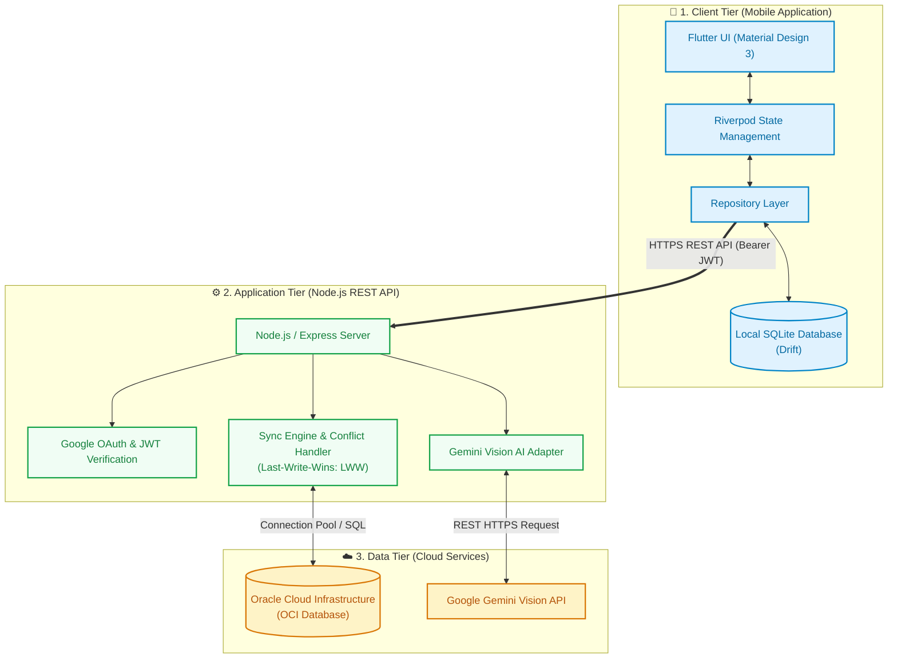
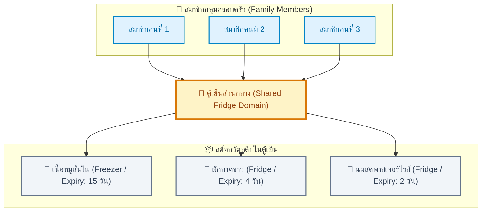
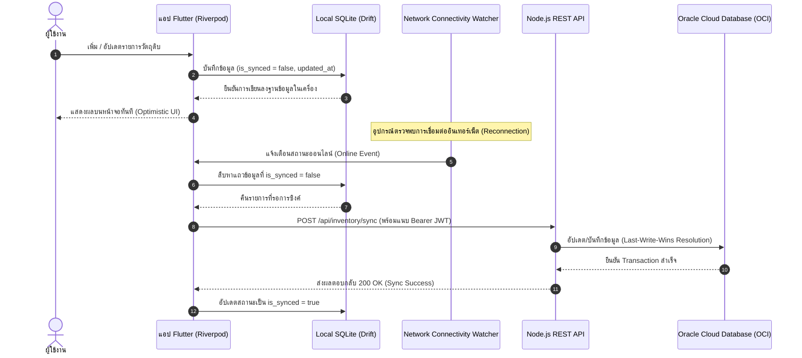
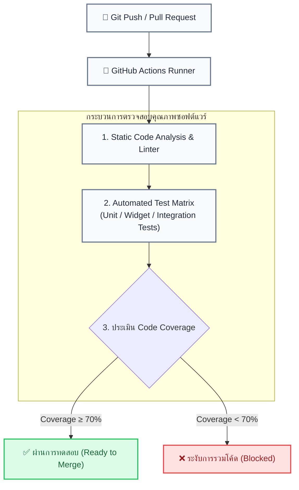

<div align="center">

# 🧊 Smart Fridge Inventory & Expiry Alert App (FM-EAA)
**แอปพลิเคชันจัดการสต็อกวัตถุดิบในตู้เย็นและแจ้งเตือนวันหมดอายุอัจฉริยะ**
*พัฒนาขึ้นสำหรับโครงงานรายวิชา MDSD-2026*

[](https://flutter.dev)
[](https://riverpod.dev)
[-003B57?logo=sqlite&logoColor=white&style=for-the-badge)](https://drift.simonbinder.eu/)
[](https://nodejs.org)
[-F80000?logo=oracle&logoColor=white&style=for-the-badge)](https://cloud.oracle.com)
[](https://ai.google.dev)

<p align="center">
  แอปพลิเคชันช่วยลดปัญหาขยะอาหาร (Food Waste) และลดค่าใช้จ่ายในบ้านด้วยระบบจัดการสต็อกแบบ Offline-First<br/>
  ใช้งานได้แม้ไม่มีเน็ต พร้อมระบบ Auto-Sync ขึ้น Oracle Cloud และระบบอ่านฉลากหาวันหมดอายุอัตโนมัติด้วย Gemini Vision API
</p>

---

</div>

## 📌 สารบัญ (Table of Contents)

- [💡 ที่มาและความสำคัญ (Problem & Solution)](#-ที่มาและความสำคัญ-problem--solution)
- [✨ ฟีเจอร์เด่นของระบบ (Key Features)](#-ฟีเจอร์เด่นของระบบ-key-features)
- [📐 สถาปัตยกรรมระบบ (System Architecture)](#-สถาปัตยกรรมระบบ-system-architecture)
  - [1. สถาปัตยกรรมแบบ 3-Tier (3-Tier Architecture)](#1-สถาปัตยกรรมแบบ-3-tier-3-tier-architecture)
  - [2. โครงสร้างตู้เย็นครอบครัว (Shared Fridge Domain Model)](#2-โครงสร้างตู้เย็นครอบครัว-shared-fridge-domain-model)
- [🔄 ลอจิกการทำงานหลัก (Core Technical Flows)](#-ลอจิกการทำงานหลัก-core-technical-flows)
  - [1. ระบบจัดเก็บข้อมูลแบบ Offline-First (Local SQLite Storage)](#1-ระบบจัดเก็บข้อมูลแบบ-offline-first-local-sqlite-storage)
  - [2. กลไกการซิงค์ข้อมูลอัตโนมัติ (Auto-Synchronization Engine)](#2-กลไกการซิงค์ข้อมูลอัตโนมัติ-auto-synchronization-engine)
  - [3. การวิเคราะห์ภาพถ่ายด้วย AI (Gemini Vision Processing)](#3-การวิเคราะห์ภาพถ่ายด้วย-ai-gemini-vision-processing)
  - [4. ความปลอดภัยและการยืนยันตัวตน (Authentication & Security)](#4-ความปลอดภัยและการยืนยันตัวตน-authentication--security)
- [🛠 เทคโนโลยีที่ใช้ (Tech Stack)](#-เทคโนโลยีที่ใช้-tech-stack)
- [🧪 การทดสอบและระบบ CI/CD (Testing & Automation)](#-การทดสอบและระบบ-cicd-testing--automation)
- [🚀 ขั้นตอนการติดตั้งและรันโปรเจกต์ (Getting Started)](#-ขั้นตอนการติดตั้งและรันโปรเจกต์-getting-started)
- [👥 สมาชิกผู้จัดทำ (Contributors)](#-สมาชิกผู้จัดทำ-contributors)

---

## 💡 ที่มาและความสำคัญ (Problem & Solution)

### ปัญหาที่พบ (The Problem)
* **ปัญหาขยะอาหาร (Food Waste)** คนส่วนใหญ่มักลืมของสดที่แช่ไว้ลึกในตู้เย็นจนหมดอายุหรือเน่าเสีย ทำให้ต้องทิ้งอาหารไปโดยเปล่าประโยชน์
* **ซื้อของซ้ำซ้อน** การไม่รู้ว่ามีอะไรอยู่ในตู้เย็นบ้าง ทำให้เผลอซื้อของเดิมมาซ้ำ เสียเงินโดยใช่เหตุ
* **คนในบ้านไม่รู้สต็อกร่วมกัน** สมาชิกในบ้านหรือรูมเมทไม่รู้ว่ามีวัตถุดิบอะไรเหลืออยู่ ชิ้นไหนกินไปแล้ว หรือชิ้นไหนต้องรีบกินก่อนหมดอายุ

### แนวทางการแก้ไข (The Solution)
แอปพลิเคชัน **FM-EAA** ออกแบบมาเพื่อแก้ปัญหาเหล่านี้
1. **สต็อกตู้เย็นส่วนกลาง (Shared Fridge)** รวมข้อมูลสต็อกไว้ที่ตู้เย็นของบ้าน ให้ทุกคนเห็นข้อมูลตรงกันแบบเรียลไทม์
2. **สแกนฉลากด้วย AI** ถ่ายรูปฉลากอาหาร แล้วใช้ Gemini Vision API อ่านชื่อและวันหมดอายุลงฟอร์มให้ทันที ไม่ต้องพิมพ์เอง
3. **ใช้งานแบบ Offline-First** ใช้งานและบันทึกข้อมูลได้ตลอดเวลาแม้ไม่มีเน็ต แล้วค่อยซิงค์ข้อมูลขึ้น Oracle Cloud เมื่อเชื่อมต่อได้
4. **บันทึกประวัติการใช้งาน** แยกชัดเจนว่าของชิ้นไหนกินหมด หรือชิ้นไหนต้องทิ้ง ช่วยให้เห็นพฤติกรรมและวางแผนซื้อของได้ดีขึ้น

---

## ✨ ฟีเจอร์เด่นของระบบ (Key Features)

### 1. 🥗 การแบ่งหมวดหมู่อาหารและโซนจัดเก็บ (Smart Categorization & Zoning)
* **แยกโซนจัดเก็บชัดเจน (Storage Zones)**
  * ❄️ **ช่องแช่เย็น (Fridge / Chiller)** สำหรับของสด ผัก ผลไม้ และเครื่องดื่ม
  * 🧊 **ช่องแช่แข็ง (Freezer)** สำหรับอาหารแช่แข็ง เนื้อสัตว์ และของที่เก็บได้นาน
* **หมวดหมู่อาหาร (Categories)**
  * 🥩 **Proteins** เนื้อสัตว์ อาหารทะเล ไข่ เต้าหู้
  * 🥦 **Veggies** ผักสด ผลไม้ สมุนไพร
  * 🧃 **Beverages** นม น้ำผลไม้ เครื่องดื่มบรรจุขวด
  * 🍱 **Meals** อาหารปรุงสำเร็จ อาหารพร้อมทาน
  * 🥫 **Sauces** เครื่องปรุงรส ซอส แยม
  * 🌐 **All** แสดงรายการวัตถุดิบทั่วทั้งตู้เย็น
* **แถบสีบอกสถานะความสดใหม่ (Freshness Visual Cues)**
  * 🟢 **สีเขียว** วัตถุดิบยังสดใหม่ ปลอดภัย
  * 🟡 **สีเหลือง** ใกล้หมดอายุ (Expiring Soon) ควรรีบนำมารับประทาน
  * 🔴 **สีแดง** หมดอายุแล้ว (Expired) ไม่ควรนำมารับประทาน

### 2. 🔍 ระบบค้นหาวัตถุดิบ (Global Search)
* ค้นหาของในตู้เย็นได้ทันทีผ่านช่องค้นหาเดียว ไม่ว่าจะอยู่ในช่องแช่เย็นหรือช่องแช่แข็ง
* กรองตามชื่อ หมวดหมู่ และโซนจัดเก็บได้รวดเร็วผ่าน Index ของฐานข้อมูลในเครื่อง

### 3. 📜 ระบบบันทึกประวัติการใช้งาน (Action History)
* บันทึกประวัติทุกครั้งที่มีการอัปเดตสถานะวัตถุดิบ
  * 🍽️ **บริโภคสำเร็จ (Consumed)** ของที่นำไปทำอาหารหรือกินหมดแล้ว
  * 🗑️ **ทิ้ง / เน่าเสีย (Discarded)** ของที่เน่าเสียหรือเลยวันหมดอายุ เพื่อใช้เก็บสถิติลดขยะอาหาร
* ช่วยให้กลับมาดูย้อนหลังได้ว่าซื้ออะไรมาแล้วกินไม่ทันบ่อยที่สุด

### 4. 👨‍👩‍👧‍👦 ตู้เย็นส่วนกลางและการแจ้งเตือน (Family Sharing & Smart Notifications)
* **แชร์ตู้เย็นในบ้าน (Family Group)** เชื่อมข้อมูลของในตู้เย็นเข้ากับกลุ่มครอบครัว ให้ทุกคนในบ้านช่วยกันอัปเดตสต็อกได้
* **แจ้งเตือนวันหมดอายุในเครื่อง (Offline Local Notifications)** ตั้งเวลาเตือนวันหมดอายุล่วงหน้าลงบนตัวเครื่องโดยตรง แม้ไม่ได้เชื่อมต่ออินเทอร์เน็ตก็ยังแจ้งเตือนได้ตรงเวลา

---

## 📐 สถาปัตยกรรมระบบ (System Architecture)

### 1. สถาปัตยกรรมแบบ 3-Tier (3-Tier Architecture)

โครงสร้างระบบแบ่งการทำงานออกเป็น 3 ส่วน (3-Tier Architecture) เพื่อให้จัดการโค้ดง่าย ปลอดภัย และดูแลระบบได้สะดวก



---

### 2. โครงสร้างตู้เย็นครอบครัว (Shared Fridge Domain Model)

ระบบออกแบบให้รายการวัตถุดิบผูกเข้ากับ "ตู้เย็นส่วนกลาง" ของบ้าน ทำให้สมาชิกทุกคนในบ้านสามารถเข้าถึงและอัปเดตสต็อกร่วมกันได้



---

## 🔄 ลอจิกการทำงานหลัก (Core Technical Flows)

### 1. ระบบจัดเก็บข้อมูลแบบ Offline-First (Local SQLite Storage)
* ข้อมูลทั้งหมดจะถูกเขียนและอ่านจาก SQLite ในเครื่อง (ผ่าน Drift) เป็นหลัก
* **Optimistic UI** เมื่อผู้ใช้เพิ่ม ลบ หรือแก้ไขรายการอาหาร หน้าจอจะอัปเดตผลทันทีผ่าน Riverpod โดยไม่ต้องรอเซิร์ฟเวอร์ตอบกลับ
* ระบบจะกำหนดสถานะ `is_synced = false` พร้อมบันทึก Timestamp ล่าสุดไว้ในเครื่อง เพื่อเตรียมส่งข้อมูลเมื่อเชื่อมต่อเน็ตได้

---

### 2. กลไกการซิงค์ข้อมูลอัตโนมัติ (Auto-Synchronization Engine)
* มีตัวตรวจสอบสถานะอินเทอร์เน็ตทำงานอยู่เบื้องหลัง
* เมื่ออุปกรณ์กลับมาเชื่อมต่อเน็ตได้ (Offline ➔ Online)
  1. ดึงข้อมูลที่ยังไม่ได้ซิงค์ (`is_synced = false`) ทั้งหมดจาก Drift ในเครื่อง
  2. รวมข้อมูลแล้วส่งคำขอแบบชุด (Batched Sync) ไปยัง Node.js API
  3. เซิร์ฟเวอร์ตรวจสอบและบันทึกลง Oracle Cloud Database (OCI) โดยใช้หลัก Last-Write-Wins (LWW) เพื่อจัดการกรณีข้อมูลชนกัน
  4. เมื่อเซิร์ฟเวอร์บันทึกสำเร็จ แอปจะปรับสถานะเป็น `is_synced = true` และตั้งเวลาแจ้งเตือนวันหมดอายุรอบใหม่



---

### 3. การวิเคราะห์ภาพถ่ายด้วย AI (Gemini Vision Processing)
* ผู้ใช้ถ่ายภาพฉลากอาหารหรือเลือกรูปจากเครื่อง
* แอปส่งรูปภาพผ่าน API ไปยัง **Google Gemini Vision API**
* ระบบ AI ช่วยอ่านข้อความสำคัญบนฉลาก
  * **ชื่ออาหาร (Item Name)** สกัดชื่อสินค้าหรือชนิดวัตถุดิบ
  * **วันหมดอายุ (Expiry Date)** อ่านวันที่จากข้อความบนฉลาก เช่น EXP, BBD หรือ ควรบริโภคก่อน
* **Auto-fill & Review** นำข้อมูลที่อ่านได้มากรอกลงแบบฟอร์มให้อัตโนมัติ เพื่อให้ผู้ใช้ตรวจทานและแก้ไขก่อนกดยืนยันบันทึก

---

### 4. ความปลอดภัยและการยืนยันตัวตน (Authentication & Security)
* **Google OAuth 2.0** เข้าสู่ระบบด้วยบัญชี Google ผ่าน Google Sign-In SDK บนมือถือ
* **การตรวจสอบฝั่งเซิร์ฟเวอร์** แอปส่ง Google ID Token ไปยัง Node.js API เพื่อตรวจสอบความถูกต้องและจับคู่บัญชีใน Oracle Cloud Database
* **การปกป้อง API ด้วย JWT** เซิร์ฟเวอร์ออก JSON Web Token (JWT) ให้แอปเก็บไว้ใน Secure Storage ของเครื่อง และแนบไปกับ Header `Authorization: Bearer <Token>` ทุกครั้งในการเรียกใช้งาน API

---

## 🛠 เทคโนโลยีที่ใช้ (Tech Stack)

| ส่วนของระบบ | เทคโนโลยีที่เลือกใช้ | บทบาทและหน้าที่การทำงาน |
| :--- | :--- | :--- |
| **Mobile Client** | [Flutter 3.x](https://flutter.dev) | พัฒนาแอปพลิเคชันสำหรับ iOS และ Android |
| **State Management** | [Riverpod](https://riverpod.dev) | จัดการสถานะแอปพลิเคชันแบบ Reactive และแยก Business Logic ออกจาก UI |
| **Local Database** | [Drift](https://drift.simonbinder.eu/) | ฐานข้อมูล SQLite ในเครื่อง รองรับการใช้งานแบบ Offline-First ทำงานร่วมกับ Riverpod แบบ Stream |
| **Backend Framework** | [Node.js](https://nodejs.org) (Express) | REST API สำหรับประมวลผลคำขอ จัดการข้อมูล และเชื่อมต่อฐานข้อมูล |
| **Cloud Database** | [Oracle Cloud Database (OCI)](https://cloud.oracle.com) | ฐานข้อมูล Cloud สำหรับเก็บข้อมูลผู้ใช้ สต็อกตู้เย็นส่วนกลาง และข้อมูลการซิงค์ |
| **AI Vision Engine** | [Google Gemini Vision API](https://ai.google.dev) | โมเดล AI อ่านภาพถ่ายฉลาก สกัดชื่ออาหารและวันหมดอายุ |
| **Authentication** | Google OAuth 2.0 & JWT | ระบบยืนยันตัวตนและรักษาความปลอดภัยในการเรียกใช้ API |

---

## 🧪 การทดสอบและระบบ CI/CD (Testing & Automation)

ทีมงานใช้ **GitHub Actions** ตรวจสอบคุณภาพโค้ดอัตโนมัติก่อนรวมเข้าสู่ Main Branch



* **Unit Testing** ตรวจสอบ Business Logic การคำนวณวันหมดอายุ และระบบซิงค์ข้อมูล
* **Widget Testing** ทดสอบการแสดงผลของหน้าจอและ UI Component ต่างๆ
* **Integration Testing** ทดสอบการส่งต่อข้อมูลระหว่าง Drift ในมือถือ ผ่าน API ไปยัง Oracle Cloud
* **Quality Gate** กำหนดเกณฑ์ Code Coverage ไม่ต่ำกว่า **70%** จึงจะผ่านการทดสอบและ Merge โค้ดได้

---

## 🚀 ขั้นตอนการติดตั้งและรันโปรเจกต์ (Getting Started)

### สิ่งที่ต้องเตรียมพร้อม (Prerequisites)
* [Flutter SDK](https://flutter.dev/docs/get-started/install) เวอร์ชัน 3.x ขึ้นไป
* [Node.js](https://nodejs.org/) เวอร์ชัน 18.x หรือ 20.x LTS และ npm
* บัญชีและอินสแตนซ์ [Oracle Cloud Database](https://cloud.oracle.com/) (พร้อม Wallet หรือ Connection String)
* โครงการใน [Google Cloud Console](https://console.cloud.google.com/) สำหรับ Google OAuth Client ID
* คีย์ใช้งาน [Google Gemini API Key](https://aistudio.google.com/)

---

### 1. การติดตั้งฝั่ง Backend API (Node.js)

1. เข้าไปที่โฟลเดอร์ Backend
   ```bash
   cd backend
   ```

2. ติดตั้ง Dependencies
   ```bash
   npm install
   ```

3. สร้างไฟล์ตัวแปรสภาพแวดล้อม (.env)
   ```bash
   cp .env.example .env
   ```
   ตั้งค่าตัวแปรในไฟล์ `.env`
   ```env
   PORT=5000
   ORACLE_DB_USER=your_oci_user
   ORACLE_DB_PASSWORD=your_oci_password
   ORACLE_DB_CONNECT_STRING=your_oci_connect_string
   JWT_SECRET=your_jwt_secret_key
   JWT_EXPIRES_IN=7d
   GOOGLE_CLIENT_ID=your_google_client_id.apps.googleusercontent.com
   GEMINI_API_KEY=your_gemini_vision_api_key
   ```

4. รัน Database Migration
   ```bash
   npm run db:migrate
   ```

5. รันเซิร์ฟเวอร์สำหรับ Development
   ```bash
   npm run dev
   ```

---

### 2. การติดตั้งฝั่ง Mobile Application (Flutter)

1. เข้าไปที่โฟลเดอร์ Frontend
   ```bash
   cd frontend
   ```

2. ติดตั้ง Dependencies ของ Flutter
   ```bash
   flutter pub get
   ```

3. เจนโค้ดสำหรับ Drift และ Riverpod
   ```bash
   dart run build_runner build --delete-conflicting-outputs
   ```

4. รันชุดทดสอบและวัดค่า Coverage
   ```bash
   flutter test --coverage
   ```

5. รันแอปพลิเคชันบน Emulator หรือเครื่องจริง
   ```bash
   flutter run
   ```

---

## 👥 สมาชิกผู้จัดทำ (Contributors)

โครงงานนี้พัฒนาขึ้นเพื่อการศึกษา รายวิชา **MDSD-2026** โดยทีมนักศึกษา

* **นางสาวอาทิตยา ผิวขำ** (รหัสนักศึกษา 67030260)
* **นายชนินทร์ คำวงศ์ษา** (รหัสนักศึกษา 67030281)
* **นายธนบดี บุญภมร** (รหัสนักศึกษา 67030298)
* **นายธีธัช รัตนโสภา** (รหัสนักศึกษา 67030302)
