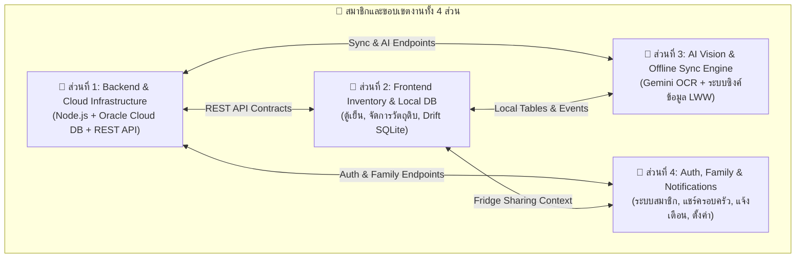

# 📋 แผนการแบ่งงานโครงงาน FM-EAA (Task Division & Responsibilities)

เอกสารฉบับนี้จัดทำขึ้นเพื่อใช้แบ่งงานและหน้าที่ความรับผิดชอบในการพัฒนาโปรเจกต์ **FM-EAA (Fridge Management & Expiry Alert App)** สำหรับสมาชิกในทีม 4 คน โดยแบ่งออกเป็น 4 ขอบเขตงาน (Modules) ที่ชัดเจน ลดการเกิดโค้ดขัดแย้ง (Merge Conflicts) และสามารถพัฒนาควบคู่กันไปได้ทันที

---

## 🗺️ ภาพรวมการแบ่งงาน (Overview Matrix)

---

## 👤 ส่วนที่ 1: Backend, Cloud Database & API Core (ฝั่งเซิร์ฟเวอร์)

> **เป้าหมาย:** สร้างและดูแลระบบเซิร์ฟเวอร์ Cloud Database, การพิสูจน์ตัวตน และ Business Logic ของ REST API ทั้งหมด

### 📁 ไฟล์และโฟลเดอร์ที่รับผิดชอบ
- `backend/src/config/` (`db.js`, `env.js`)
- `backend/src/db/migrations/001_init.sql`
- `backend/src/middleware/` (`auth.js`, `errorHandler.js`)
- `backend/src/routes/` (`authRoutes.js`, `fridgeRoutes.js`, `itemRoutes.js`, `historyRoutes.js`)
- `backend/src/services/` (`authService.js`, `fridgeService.js`, `itemService.js`)
- `backend/tests/`

### 📝 รายละเอียดงานที่ต้องทำ
1. **Oracle Cloud Infrastructure (OCI) & Database:**
   - ติดตั้งและตั้งค่า Oracle Autonomous Database หรือ Connection Pool ผ่าน `oracledb` ใน `config/db.js`
   - รัน SQL Script สร้างตารางจริงทั้ง 7 ตารางจาก `001_init.sql` (users, fridges, fridge_members, fridge_invites, items, item_history, notifications)
2. **Authentication & Security:**
   - พัฒนาระบบ Register / Login ด้วย Email/Username + Password (เข้ารหัสด้วย `bcrypt`)
   - พัฒนาระบบออกและตรวจสอบ JWT Token ใน `middleware/auth.js`
   - ตรวจสอบความถูกต้องของ Google ID Token สำหรับ Google Sign-In
   - พัฒนาระบบ Forgot Password (สร้าง Token รีเซ็ตส่งทาง Email)
3. **Core Business Logic Services:**
   - พัฒนา CRUD สำหรับตู้เย็น (Fridges) ตรวจสอบสิทธิ์ Owner / Member
   - พัฒนา CRUD สำหรับวัตถุดิบ (Items) รองรับการแบ่งโซน Fridge / Freezer และหมวดหมู่
   - พัฒนาระบบบันทึกประวัติ (History) เมื่อมีการกิน (Consumed) หรือหมดอายุ (Expired)
4. **Backend Automated Testing:**
   - เขียน Unit & Integration Tests ด้วย Jest / Supertest ให้ครอบคลุมทุก Endpoint และรักษา Code Coverage $\ge 70\%$

---

## 👤 ส่วนที่ 2: Frontend Inventory & Local Database (สต็อกวัตถุดิบและตู้เย็น)

> **เป้าหมาย:** สร้าง UI สำหรับจัดการตู้เย็น สต็อกอาหาร การค้นหา และฐานข้อมูล SQLite ในเครื่องมือถือ

### 📁 ไฟล์และโฟลเดอร์ที่รับผิดชอบ
- `frontend/lib/features/fridges/` (หน้า My Fridges, เพิ่ม/แก้ไข/ลบตู้)
- `frontend/lib/features/fridge_detail/` (หน้ารายละเอียดตู้, แท็บ Fridge/Freezer, ชิปหมวดหมู่)
- `frontend/lib/features/item/` (หน้า Add/Edit/Detail, Mark as Consumed Sheet, Undo Snackbar)
- `frontend/lib/features/search/` (หน้าค้นหาวัตถุดิบ)
- `frontend/lib/data/local/` (`app_database.dart` - ส่วนตารางและ DAO ของ Fridges & Items)
- `frontend/lib/data/repositories/` (`fridge_repository.dart`, `item_repository.dart`)

### 📝 รายละเอียดงานที่ต้องทำ
1. **Local Database (Drift SQLite):**
   - พัฒนา DAO และ Query สำหรับตาราง `FridgesTable` และ `ItemsTable` ในเครื่อง
   - พัฒนาระบบ Optimistic UI (บันทึกข้อมูลลงเครื่องทันทีก่อน พร้อมตั้งสถานะ `is_synced = false`)
2. **หน้าจอจัดการตู้เย็น (Screens #5–8):**
   - หน้ารายการตู้เย็นแบบ Grid 2 คอลัมน์ (แสดงชื่อ, จำนวนของ, ป้าย Personal หรือ N members)
   - ฟอร์มสร้างตู้เย็นใหม่ และ Bottom Sheet แก้ไข/ลบตู้เย็น
3. **หน้ารายการวัตถุดิบและค้นหา (Screens #9–10):**
   - แสดงรายการอาหารแยกตามแท็บช่องธรรมดา (Fridge) และช่องแช่แข็ง (Freezer)
   - ป้ายสถานะความสด: **Fresh** (เขียว), **Use soon** (ส้ม), **Expired** (แดง) พร้อมระบุจำนวนวันที่เหลือ
   - แถบวงกลมกรองหมวดหมู่: All, Proteins, Veggies, Beverages, Meals, Sauces
   - ระบบค้นหาวัตถุดิบตามคีย์เวิร์ดแบบ Real-time พร้อมปุ่มล้างคำค้น
4. **ฟอร์มวัตถุดิบและการกินของ (Screens #11–16):**
   - ฟอร์มเพิ่ม/แก้ไขวัตถุดิบ (Food Name, Category, Quantity, Unit, Storage Location, Expiry Date)
   - Flow **"Mark as Consumed"**: Bottom Sheet เลือกลดจำนวนที่บริโภค หรือกด **"Finished all"**
   - แสดง Snackbar ยืนยันการกิน พร้อมปุ่ม **Undo** เพื่อย้อนสถานะกลับได้

---

## 👤 ส่วนที่ 3: AI Vision & Offline-First Sync Engine (ระบบ AI และการซิงค์ข้อมูล)

> **เป้าหมาย:** พัฒนาระบบสแกนฉลากด้วย Gemini Vision API และเครื่องมือเชื่อมโยงข้อมูลระหว่างมือถือกับ Cloud Database

### 📁 ไฟล์และโฟลเดอร์ที่รับผิดชอบ
- `frontend/lib/features/item/presentation/pages/scan_label_page.dart`
- `frontend/lib/features/item/presentation/pages/barcode_scanner_page.dart`
- `frontend/lib/sync/` (`sync_engine.dart`, `connectivity_watcher.dart`)
- `backend/src/routes/aiRoutes.js`, `backend/src/services/aiService.js`
- `backend/src/routes/syncRoutes.js`, `backend/src/services/syncService.js`

### 📝 รายละเอียดงานที่ต้องทำ
1. **AI Vision Label Scanning (Gemini API):**
   - ฝั่ง Frontend: เปิดกล้องหรือเลือกภาพฉลากอาหารจากคลังภาพ (`image_picker`) แสดงหน้าจอพรีวิว
   - ฝั่ง Backend: รับรูปภาพ Base64/Multipart แล้วส่งต่อไปยัง **Google Gemini Vision API** ด้วย Prompt วิเคราะห์ฉลากอาหาร
   - สกัดข้อมูลสำคัญ: **ชื่ออาหาร (Food Name)** และ **วันหมดอายุ (Expiry Date)**
   - ส่งผลลัพธ์กลับมายังมือถือ และ Auto-fill ข้อมูลลงในแบบฟอร์ม Add Item ให้อัตโนมัติ
2. **Connectivity Watcher:**
   - ใช้ `connectivity_plus` ตรวจสอบสถานะการเชื่อมต่อเครือข่ายเบื้องหลัง
   - แจ้งเตือนเมื่ออุปกรณ์เปลี่ยนสถานะจาก Offline เป็น Online
3. **Batched Synchronization Engine:**
   - ดึงรายการที่มีการเปลี่ยนแปลงในเครื่อง (`is_synced = false`) รวมส่งเป็น Batch ไปยัง `POST /api/sync`
   - ฝั่ง Backend บันทึกลง Oracle Cloud โดยใช้หลักการ **Last-Write-Wins (LWW)** อิงตามฟิลด์ `updated_at`
   - อัปเดตสถานะในเครื่องเป็น `is_synced = true` เมื่อซิงค์สำเร็จ
   - ปรับการซิงค์ให้ครอบคลุมขอบเขตรายตู้เย็น (Scoping by `fridge_id`) เพื่อรองรับการแชร์ตู้

---

## 👤 ส่วนที่ 4: Auth, Family Sharing, History & Notifications (ระบบสมาชิกและการแจ้งเตือน)

> **เป้าหมาย:** ดูแลระบบสิทธิ์ผู้ใช้ การแชร์ตู้เย็นกับครอบครัว ประวัติการบริโภค และระบบแจ้งเตือนเตือนวันหมดอายุ

### 📁 ไฟล์และโฟลเดอร์ที่รับผิดชอบ
- `frontend/lib/features/auth/` (Onboarding, Sign In, Register, Forgot Password)
- `frontend/lib/features/family/` (Family Share, Invite Member, Remove Member)
- `frontend/lib/features/history/` (หน้าประวัติ Consumed & Expired)
- `frontend/lib/features/notifications/` (หน้ารายการแจ้งเตือน)
- `frontend/lib/features/settings/` (ตั้งค่า, โปรไฟล์, เปลี่ยนภาษา/ธีม)
- `frontend/lib/core/notifications/notification_service.dart`
- `backend/src/routes/userRoutes.js`, `notificationRoutes.js`

### 📝 รายละเอียดงานที่ต้องทำ
1. **Authentication Flow (Screens #1–4):**
   - หน้า Onboarding & Permission (แนะนำแอปและขอสิทธิ์การแจ้งเตือน)
   - หน้า Sign In / Create Account (พร้อมระบบ Validate รหัสผ่าน $\ge 8$ ตัวอักษร)
   - เชื่อมต่อ Google Sign-In SDK และหน้า Reset Password
2. **Family Sharing (Screens #18–20):**
   - แสดงรายชื่อสมาชิกในตู้เย็น พร้อมระบุบทบาท **Owner** หรือ **Member**
   - ค้นหาผู้ใช้ด้วย Username เพื่อส่งคำเชิญเข้าร่วมตู้เย็น
   - จัดการสิทธิ์การลบสมาชิกออกจากตู้ (เฉพาะ Owner)
3. **ระบบประวัติการใช้งาน (History - Screen #17):**
   - แยก 2 แท็บ: 🍽️ **Consumed** (ของที่กินแล้ว) และ ⏰ **Expired** (ของที่หมดอายุ)
   - บันทึกชื่อผู้ทำรายการ (`@username`) และวันเวลาในแต่ละรายการ
   - ปุ่มลบรายการเดี่ยว และปุ่ม **Clear All**
   - พัฒนา Background Routine ลบประวัติเก่าอัตโนมัติเมื่อครบ 30 วัน
4. **ระบบแจ้งเตือน (Notifications - Screen #21):**
   - **Offline Local Notifications:** ตั้งเวลาแจ้งเตือนล่วงหน้าเมื่อของใกล้หมดอายุบนเครื่อง (`flutter_local_notifications`)
   - **In-App Notifications:** แสดงคำเชิญเข้าตู้ พร้อมปุ่มยอมรับ (**Accept**) หรือปฏิเสธ (**Decline**)
5. **การตั้งค่าและธีม (Settings - Screens #22–24):**
   - แก้ไขข้อมูลส่วนตัว (Name, Email, Profile Picture, เปลี่ยนรหัสผ่าน)
   - สลับภาษา **TH / EN** และสลับธีม **Light / Dark** (Material 3)
   - ไดอะล็อกยืนยันการออกจากระบบ (Log Out)

---

## 📌 สรุปการเชื่อมโยงกับโค้ด Skeleton ปัจจุบัน

- ทุกหน้าจอใน `frontend/lib/features/` มีคอมเมนต์ระบุ `// TODO(screen #...):` และจัดวาง Widget โครงสร้างไว้แล้ว
- รายละเอียดเลข Node ใน Figma และเส้นทาง Route สามารถเปิดเทียบได้จากเอกสาร [`docs/SCREENS.md`](SCREENS.md)
- ดีไซน์ โทเคนสี และข้อกำหนดทางเทคนิคทั้งหมด อ้างอิงจาก [`docs/DESIGN_SPEC.md`](DESIGN_SPEC.md)

