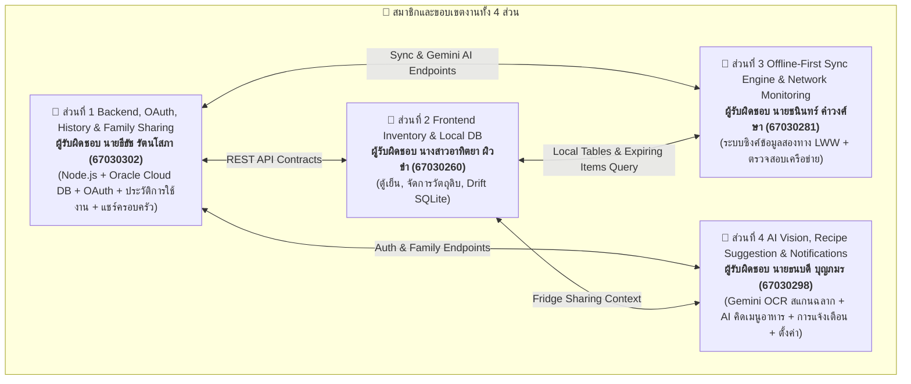
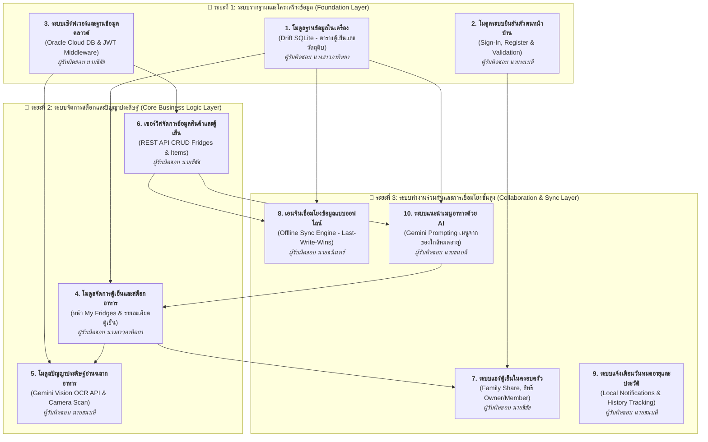

# 📋 แผนการแบ่งงานโครงงาน FM-EAA (Task Division & Responsibilities)

เอกสารฉบับนี้จัดทำขึ้นเพื่อใช้แบ่งงานและหน้าที่ความรับผิดชอบในการพัฒนาโปรเจกต์ **FM-EAA (Fridge Management & Expiry Alert App)** สำหรับสมาชิกในทีม 4 คน โดยระบุผู้รับผิดชอบหลักในแต่ละโมดูลอย่างชัดเจน เพื่อลดการเกิดโค้ดขัดแย้ง (Merge Conflicts) และสามารถพัฒนาควบคู่กันไปได้อย่างมีประสิทธิภาพ

---

## 🗺️ ภาพรวมการแบ่งงาน (Overview Matrix)

### ตารางสรุปหน้าที่และความรับผิดชอบ

| ส่วนที่ | ขอบเขตงาน (Module) | ผู้รับผิดชอบหลัก | รหัสนักศึกษา | หน้าที่หลักโดยสรุป |
| :---: | :--- | :--- | :---: | :--- |
| **1** | **Backend, OAuth, History & Family Sharing** | **นายธีธัช รัตนโสภา** | 67030302 | Oracle Cloud DB (OCI), Database Migrations, REST API Core, Google OAuth 2.0, ระบบสมาชิก, ระบบแชร์ตู้เย็นกับครอบครัว (Family Share), และระบบประวัติการใช้งาน (Consumed/Expired) |
| **2** | **Frontend Inventory & Local DB** | **นางสาวอาทิตยา ผิวขำ** | 67030260 | Drift SQLite, หน้ารายการตู้เย็น (My Fridges), หน้าสต็อกวัตถุดิบ (Fridge Detail), ฟอร์มสินค้า, Consume Flow และรองรับตัดสต็อกจากการปรุงอาหาร |
| **3** | **Offline Sync & AI Architecture Foundation** | **นายชนินทร์ คำวงศ์ษา** | 67030281 | วางโครงสร้างสถาปัตยกรรมระบบ AI เริ่มต้น (Gemini Vision OCR & AI Prompt Pipeline), ตรวจสอบเครือข่ายเบื้องหลัง และระบบ Auto-Sync สองทาง (LWW) |
| **4** | **AI Features, Notifications & Code Coverage** | **นายธนบดี บุญภมร** | 67030298 | พัฒนาต่อยอดระบบ AI สมบูรณ์, ระบบแจ้งเตือน, การตั้งค่า และ**รับผิดชอบระบบ Code Coverage & CI/CD ทั้งหมดของโปรเจกต์ (76%+)** |

---

## 🚦 ลำดับขั้นตอนการพัฒนาและความสัมพันธ์ระหว่างโมดูล (Module Dependencies & Integration Roadmap)

> 💡 **หลักการพัฒนาและการเชื่อมต่อระบบ (Integration Principles):**
> 1. **พัฒนาจากโมดูลรากฐานขึ้นสู่โมดูลระดับบน (Foundation-First Architecture):** ระบบต้องมีฐานข้อมูล (Database) และโครงสร้างการยืนยันตัวตน (Authentication) ที่นิ่งก่อน จึงจะสามารถพัฒนาหน้าจอและฟังก์ชันธุรกิจ (Business Logic) ต่อยอดได้
> 2. **การรวมโค้ดแบบทีละขั้น (Incremental Integration):** เมื่อแต่ละโมดูลย่อยพัฒนาและผ่านการทดสอบ (Automated Tests) เรียบร้อยแล้ว จึงทำการรวมเข้าสู่กิ่งหลัก (`develop`) เพื่อป้องกันข้อขัดแย้งของโค้ด (Merge Conflicts)
> 3. **รักษามาตรฐานความเข้ากันได้ของข้อมูล (Data Contract Integrity):** โครงสร้างโมเดลและฟิลด์ข้อมูลใน Local DB (Drift) และ Cloud DB (Oracle) ต้องสอดคล้องกันทุกจุด

### 📊 ตารางลำดับการผสานระบบ (Module Integration Sequence)

| ลำดับ | โมดูลงาน (Module Component) | ผู้รับผิดชอบหลัก | ความสัมพันธ์กับระบบอื่น (Prerequisites) | ความสำคัญ |
| :---: | :--- | :--- | :--- | :---: |
| 1 | ระบบฐานข้อมูลภายในเครื่อง (Local SQLite Database) | นางสาวอาทิตยา | เป็นรากฐานของแอปทั้งหมด จัดเตรียมตาราง FridgesTable, ItemsTable | 🔴 ชั้นรากฐาน (Foundation) |
| 2 | ระบบยืนยันตัวตนฝั่งผู้ใช้ (Client-Side Authentication) | นายธนบดี | วางโครงสร้างฟอร์มเข้าสู่ระบบ, สมัครสมาชิก และการตรวจสอบความถูกต้องของข้อมูล | 🔴 ชั้นรากฐาน (Foundation) |
| 3 | ระบบเซิร์ฟเวอร์และฐานข้อมูลกลาง (Cloud Database & Auth Core) | นายธีธัช | ติดตั้ง Oracle Cloud DB, ตารางหลัก 7 ตาราง และ authenticateToken middleware | 🔴 ชั้นรากฐาน (Foundation) |
| 4 | ระบบส่วนต่อประสานจัดการตู้เย็น (Fridge Management UI) | นางสาวอาทิตยา | ต้องอาศัย Local DB (ลำดับ 1) เพื่อบันทึกและแสดงผลรายการตู้เย็นและของในตู้ | 🟡 ฟังก์ชันหลัก (Core) |
| 5 | ระบบวิเคราะห์ฉลากอาหารด้วยปัญญาประดิษฐ์ (AI Vision OCR) | นายธนบดี | อาศัย authenticateToken จากลำดับ 3 และส่งข้อมูลกลับไปยังแบบฟอร์มในลำดับ 4 | 🟡 ฟังก์ชันหลัก (Core) |
| 6 | ระบบบริการข้อมูลวัตถุดิบบนคลาวด์ (Cloud Inventory Services) | นายธีธัช | พัฒนา REST API รองรับการดึงและอัปเดตข้อมูลตู้เย็นและวัตถุดิบบน Oracle Cloud | 🟡 ฟังก์ชันหลัก (Core) |
| 7 | ระบบแบ่งปันตู้เย็นกับครอบครัว (Family Sharing Module) | นายธีธัช | อาศัยข้อมูลผู้ใช้ (ลำดับ 2) และข้อมูลตู้เย็น (ลำดับ 4) ในการจัดการสิทธิ์การเข้าถึง | 🟢 ระบบขั้นสูง (Advanced) |
| 8 | ระบบประสานข้อมูลแบบออฟไลน์ (Offline-First Sync Engine) | นายชนินทร์ | เชื่อมโยงข้อมูลระหว่าง Local DB (ลำดับ 1) กับ Cloud Services (ลำดับ 6) ด้วยหลัก LWW | 🟢 ระบบขั้นสูง (Advanced) |
| 9 | ระบบแจ้งเตือนเตือนวันหมดอายุ (Alerts & Notifications) | นายธนบดี | ดึงข้อมูลวันหมดอายุจากสต็อกอาหาร เพื่อตั้งเวลาแจ้งเตือนล่วงหน้าบนอุปกรณ์ 3 หมุดหมาย | 🟢 ระบบขั้นสูง (Advanced) |
| 10 | ระบบแนะนำเมนูอาหารจากวัตถุดิบใกล้หมดอายุด้วยปัญญาประดิษฐ์ (AI Recipe Recommendation) | นายธนบดี | อาศัยข้อมูลวัตถุดิบสถานะ Use soon จาก Local DB (ลำดับ 1, 4) และเรียกใช้ Gemini AI API เพื่อแนะนำเมนูพร้อมหักลดยอดวัตถุดิบ | 🟢 ระบบขั้นสูง (Advanced) |

---

### 📋 ลำดับขั้นตอนการพัฒนาเจาะจงตามขอบเขตงาน (Role-Based Implementation Steps)

#### 👤 ส่วนที่ 1 นายธีธัช รัตนโสภา (Backend, OAuth, History & Family Sharing)
- ✅ **ขั้นที่ 1** กำหนดค่าการเชื่อมต่อ Oracle Cloud DB ใน `backend/src/config/db.js` และรัน migration `001_init.sql` เพื่อสร้างตารางข้อมูลทั้ง 7 ตารางบนระบบคลาวด์
- ✅ **ขั้นที่ 2** พัฒนาระบบยืนยันตัวตนใน `authService.js` และ `authRoutes.js` (Register, Login, Password Hashing ด้วย `bcrypt`, และการตรวจสอบ Google OAuth 2.0 พร้อมออก JWT Token)
- ✅ **ขั้นที่ 3** จัดทำ `authenticateToken` ใน `middleware/auth.js` สำหรับตรวจสอบสิทธิ์การเข้าถึง API ทุกเส้นทาง
- ✅ **ขั้นที่ 4** พัฒนาระบบสมาชิกและแชร์ตู้เย็นครอบครัว (Screens #18–20: `FamilySharePage`, `InviteMemberPage`, `RemoveMemberDialog` พร้อม `inviteRoutes.js`, `fridgeRoutes.js`)
- ✅ **ขั้นที่ 5** พัฒนาระบบประวัติการใช้งานตู้เย็น (Screen #17: `HistoryPage` แยกแท็บ Consumed/Expired พร้อมปุ่มล้างประวัติเดี่ยว, Clear All, Background Routine ลบอัตโนมัติ 30 วัน และ `historyRoutes.js`, `historyService.js`)
- ✅ **ขั้นที่ 6** ร่วมทดสอบการทำงานของระบบ API (Integration Testing) ตรวจสอบความถูกต้องของ Auth, OAuth, Family Share, History และการทำงานร่วมกับฐานข้อมูล

#### 👤 ส่วนที่ 2 นางสาวอาทิตยา ผิวขำ (Frontend Inventory & Local DB)
- ✅ **ขั้นที่ 1** พัฒนาระบบฐานข้อมูล Drift SQLite ในเครื่อง (`app_database.dart`) ให้รองรับตาราง `FridgesTable` และ `ItemsTable` แบบออฟไลน์
- ✅ **ขั้นที่ 2** พัฒนาหน้าจอแสดงรายการตู้เย็นและฟอร์มสร้าง/แก้ไขตู้เย็น (Screens #5–8: `MyFridgesPage`, `AddFridgePage`, `EditFridgeSheet`)
- ✅ **ขั้นที่ 3** พัฒนาหน้ารายละเอียดวัตถุดิบภายในตู้เย็นและการกรอง (Screen #9: `FridgeDetailPage` แยกแท็บ Fridge/Freezer และชิปหมวดหมู่ พร้อมเชื่อมต่อ Local DB)
- ✅ **ขั้นที่ 4** พัฒนาระบบค้นหาวัตถุดิบ (Screen #10: `SearchPage` ค้นหาแบบ Real-time พร้อมปุ่มล้างคำค้น)
- ✅ **ขั้นที่ 5** พัฒนาแบบฟอร์มการบันทึกและแก้ไขวัตถุดิบ (Screens #11–13: `AddItemPage`, `EditItemPage`, `ItemDetailsPage`)
- ✅ **ขั้นที่ 6** พัฒนาระบบบันทึกการบริโภคอาหาร (Screens #14–16: Mark as Consumed Sheet, Finished all, และ Undo SnackBar)
- ✅ **ขั้นที่ 7** พัฒนาระบบคิวรีวัตถุดิบใกล้หมดอายุและเชื่อมต่อระบบตัดสต็อกอาหารอัตโนมัติ (Screens #9, #14–16) เพื่อรองรับระบบ AI แนะนำเมนู (Screens #25–26)
- ✅ **ขั้นที่ 8** ร่วมทดสอบการใช้งานจริงบนแอปพลิเคชัน (Functional Testing) ตรวจสอบการจัดการตู้เย็น สต็อกวัตถุดิบ และแก้ไขปัญหา UI

#### 👤 ส่วนที่ 3 นายชนินทร์ คำวงศ์ษา (Offline-First Sync Engine & Network Resilience)
- ✅ **ขั้นที่ 1** วางโครงสร้างสถาปัตยกรรมระบบ AI เริ่มต้น (Initial AI Architecture & Pipeline) กำหนด Interface การเชื่อมต่อ Gemini Vision API และออกแบบ Schema เบื้องต้น
- ✅ **ขั้นที่ 2** พัฒนาระบบตรวจสอบสถานะการเชื่อมต่อเครือข่ายเบื้องหลัง (`connectivity_watcher.dart`) ด้วย `connectivity_plus`
- ✅ **ขั้นที่ 3** พัฒนาระบบซิงค์ข้อมูลฝั่งเซิร์ฟเวอร์ (`syncRoutes.js`, `syncService.js`) รองรับ Last-Write-Wins (LWW) อิงตาม `updated_at`
- ✅ **ขั้นที่ 4** พัฒนาระบบประมวลผลการซิงค์ฝั่งมือถือ (`sync_engine.dart`) รวมส่งข้อมูลแบบ Batched และจัดการสถานะ `is_synced` ครอบคลุมขอบเขตรายตู้เย็น (`fridge_id`)
- ✅ **ขั้นที่ 5** ร่วมทดสอบการใช้งานจริงบนแอปพลิเคชันและการทำงานของระบบซิงค์ (Functional & Network Testing) ตรวจสอบการสลับโหมดออนไลน์/ออฟไลน์

#### 👤 ส่วนที่ 4 นายธนบดี บุญภมร (AI Vision, Recipe Suggestion & Notifications)
- ✅ **ขั้นที่ 1** พัฒนาต่อยอดระบบวิเคราะห์ฉลากอาหารจากโครงสร้างตั้งต้น (`aiService.js`, `aiRoutes.js`, `ai_repository.dart`) เชื่อมต่อ Google Gemini 3.5 Flash Lite สกัดชื่ออาหาร วันหมดอายุ พร้อมระบบ Confidence Guard จนเสร็จสมบูรณ์
- ✅ **ขั้นที่ 2** พัฒนาหน้าจอการสแกนฉลากด้วยกล้องบนมือถือ (`scan_label_page.dart`) และระบบนำผลลัพธ์มา Autofill ข้อมูลลงแบบฟอร์มวัตถุดิบ รองรับทั้งกล้องและรูปถ่าย
- ✅ **ขั้นที่ 3** พัฒนาระบบปัญญาประดิษฐ์แนะนำเมนูอาหารและรายละเอียดสูตรจนสำเร็จสมบูรณ์ (Screens #25–26: `recipe_recommendation_page.dart`, `recipe_detail_page.dart` พร้อม `recipe_provider.dart`) ด้วย Structured Prompt ลดปัญหาขยะอาหาร และระบบตัดสต็อกอัตโนมัติ
- ✅ **ขั้นที่ 4** พัฒนาระบบแจ้งเตือนบนอุปกรณ์ (Screen #21: `NotificationsPage` และ Local Notifications เตือนของใกล้หมดอายุล่วงหน้า 3 หมุดหมาย)
- ✅ **ขั้นที่ 5** พัฒนาหน้าจอการตั้งค่าและโปรไฟล์ (Screens #22–24: `SettingsPage`, `EditProfilePage` รองรับการสลับธีม/ภาษา และการออกจากระบบ)
- ✅ **ขั้นที่ 6** ร่วมทดสอบการใช้งานจริงบนแอปพลิเคชัน (Functional Testing) สแกนฉลากอาหาร ตรวจสอบการแจ้งเตือน เมนูอาหาร และการตั้งค่า
- ✅ **ขั้นที่ 7** พัฒนาและดูแลระบบ Code Coverage ทั้งหมดของโปรเจกต์ (ทั้ง Frontend และ Backend) ควบคุมเกณฑ์คุณภาพบน GitHub Actions CI ให้ผ่านตามเป้าหมาย (ได้ 76%+ เกินเกณฑ์ 70%)

---

## 👤 ส่วนที่ 1 Backend, OAuth, History & Family Sharing (ฝั่งเซิร์ฟเวอร์, ความปลอดภัย, ประวัติ และระบบแชร์)
**ผู้รับผิดชอบ** นายธีธัช รัตนโสภา (67030302)

> **เป้าหมาย** สร้างและดูแลระบบเซิร์ฟเวอร์ Cloud Database, การพิสูจน์ตัวตนด้วย Google OAuth 2.0, ระบบประวัติการใช้งานตู้เย็น (Consumed/Expired) และระบบแชร์ตู้เย็นในครอบครัว

### 📁 ไฟล์และโฟลเดอร์ที่รับผิดชอบ
- `backend/src/config/` (`db.js`, `env.js`)
- `backend/src/db/migrations/001_init.sql`
- `backend/src/middleware/` (`auth.js`, `errorHandler.js`)
- `backend/src/routes/` (`authRoutes.js`, `fridgeRoutes.js`, `historyRoutes.js`, `inviteRoutes.js`)
- `backend/src/services/` (`authService.js`, `fridgeService.js`, `historyService.js`)
- `frontend/lib/features/history/` (หน้าประวัติ Consumed & Expired)
- `frontend/lib/features/family/` (Family Share, Invite Member, Remove Member)
- `backend/tests/`

### 📝 รายละเอียดงานที่ต้องทำ
1. **Oracle Cloud Infrastructure (OCI) & Database**
   - ติดตั้งและตั้งค่า Oracle Autonomous Database หรือ Connection Pool ผ่าน `oracledb` ใน `config/db.js`
   - รัน SQL Script สร้างตารางจริงทั้ง 7 ตารางจาก `001_init.sql` (users, fridges, fridge_members, fridge_invites, items, item_history, notifications)
2. **Authentication, Google OAuth & Security**
   - พัฒนาระบบ Register / Login ด้วย Email/Username + Password (เข้ารหัสด้วย `bcrypt`)
   - พัฒนาระบบยืนยันตัวตนด้วย **Google OAuth 2.0** ตรวจสอบความถูกต้องของ Google ID Token ฝั่งเซิร์ฟเวอร์
   - พัฒนาระบบออกและตรวจสอบ JWT Token ใน `middleware/auth.js` และระบบ Forgot Password ทางอีเมล
3. **ระบบประวัติการใช้งานตู้เย็น (History - Screen #17)**
   - พัฒนาหน้าจอและบริการประวัติแยก 2 แท็บ 🍽️ **Consumed** (ของที่กินแล้ว) และ ⏰ **Expired** (ของที่หมดอายุ)
   - บันทึกชื่อผู้ทำรายการ (`@username`) และวันเวลาในแต่ละรายการ
   - ปุ่มลบรายการเดี่ยว และปุ่ม **Clear All** พร้อมพัฒนา Background Routine ลบประวัติเก่าอัตโนมัติเมื่อครบ 30 วัน
4. **Family Sharing & Fridge Access Control (Screens #18–20)**
   - แสดงรายชื่อสมาชิกในตู้เย็น พร้อมระบุบทบาท **Owner** หรือ **Member**
   - ค้นหาผู้ใช้ด้วย Username เพื่อส่งคำเชิญเข้าร่วมตู้เย็น
   - จัดการสิทธิ์การลบสมาชิกออกจากตู้ (เฉพาะ Owner) และกดยอมรับ/ปฏิเสธคำเชิญ
5. **Backend Automated Testing**
   - เขียน Unit & Integration Tests ด้วย Jest / Supertest ให้ครอบคลุมทุก Endpoint และรักษา Code Coverage >= 70%

## 👤 ส่วนที่ 2 Frontend Inventory & Local Database (สต็อกวัตถุดิบและตู้เย็น)
**ผู้รับผิดชอบ** นางสาวอาทิตยา ผิวขำ (67030260)

> **เป้าหมาย** สร้าง UI สำหรับจัดการตู้เย็น สต็อกอาหาร การค้นหา และฐานข้อมูล SQLite ในเครื่องมือถือ

### 📁 ไฟล์และโฟลเดอร์ที่รับผิดชอบ
- `frontend/lib/features/fridges/` (หน้า My Fridges, เพิ่ม/แก้ไข/ลบตู้)
- `frontend/lib/features/fridge_detail/` (หน้ารายละเอียดตู้, แท็บ Fridge/Freezer, ชิปหมวดหมู่)
- `frontend/lib/features/item/` (หน้า Add/Edit/Detail, Mark as Consumed Sheet, Undo Snackbar)
- `frontend/lib/features/search/` (หน้าค้นหาวัตถุดิบ)
- `frontend/lib/data/local/` (`app_database.dart` - ส่วนตารางและ DAO ของ Fridges & Items)
- `frontend/lib/data/repositories/` (`fridge_repository.dart`, `item_repository.dart`)

### 📝 รายละเอียดงานที่ต้องทำ
1. **Local Database (Drift SQLite)**
   - พัฒนา DAO และ Query สำหรับตาราง `FridgesTable` และ `ItemsTable` ในเครื่อง
   - พัฒนาระบบ Optimistic UI (บันทึกข้อมูลลงเครื่องทันทีก่อน พร้อมตั้งสถานะ `is_synced = false`)
2. **หน้าจอจัดการตู้เย็น (Screens #5–8)**
   - หน้ารายการตู้เย็นแบบ Grid 2 คอลัมน์ (แสดงชื่อ, จำนวนของ, ป้าย Personal หรือ N members ปรับดีไซน์ UI คลีนโดยตัดแบนเนอร์สรุปออก)
   - ฟอร์มสร้างตู้เย็นใหม่ และ Bottom Sheet แก้ไข/ลบตู้เย็น
3. **หน้ารายการวัตถุดิบและค้นหา (Screens #9–10)**
   - แสดงรายการอาหารแยกตามแท็บช่องธรรมดา (Fridge) และช่องแช่แข็ง (Freezer)
   - ป้ายสถานะความสด **Fresh** (เขียว), **Use soon** (ส้ม), **Expired** (แดง) พร้อมระบุจำนวนวันที่เหลือ
   - แถบวงกลมกรองหมวดหมู่ All, Proteins, Veggies, Beverages, Meals, Sauces
   - ระบบค้นหาวัตถุดิบตามคีย์เวิร์ดแบบ Real-time พร้อมปุ่มล้างคำค้น
4. **ฟอร์มวัตถุดิบและการกินของ (Screens #11–16)**
   - ฟอร์มเพิ่ม/แก้ไขวัตถุดิบ (Food Name, Category, Quantity, Unit, Storage Location, Expiry Date)
   - Flow **"Mark as Consumed"** Bottom Sheet เลือกลดจำนวนที่บริโภค หรือกด **"Finished all"**
   - แสดง Snackbar ยืนยันการกิน พร้อมปุ่ม **Undo** เพื่อย้อนสถานะกลับได้
5. **การเชื่อมโยงระบบตัดสต็อกอาหารอัตโนมัติ (Screens #9, #14–16)**
   - จัดเตรียมฟังก์ชัน `getExpiringSoonItems` ใน `ItemDao` เพื่อดึงรายการวัตถุดิบสถานะ **Use soon** ($\le 2$ วัน) จากหน้าสต็อกอาหาร (Screen #9) ส่งต่อให้ระบบ AI
   - รองรับคำสั่งตัดสต็อกอาหารอัตโนมัติ (Consume Flow ใน Screens #14–16) เมื่อผู้ใช้กดยืนยันทำอาหารจากหน้าระบบ AI แนะนำเมนู (Screens #25–26) พร้อมบันทึกลงประวัติ History ใน Local Database

---

## 👤 ส่วนที่ 3 Offline-First Sync Engine & Network Resilience (ระบบซิงค์ข้อมูลออฟไลน์)
**ผู้รับผิดชอบ** นายชนินทร์ คำวงศ์ษา (67030281)

> **เป้าหมาย** พัฒนาระบบตรวจสอบเครือข่ายและเอนจินเชื่อมโยงข้อมูลแบบ Offline-First ระหว่างมือถือกับ Cloud Database ด้วยหลัก Last-Write-Wins

### 📁 ไฟล์และโฟลเดอร์ที่รับผิดชอบ
- `frontend/lib/sync/` (`sync_engine.dart`, `connectivity_watcher.dart`)
- `backend/src/routes/syncRoutes.js`, `backend/src/services/syncService.js`
- `frontend/test/sync_engine_test.dart`, `frontend/test/connectivity_watcher_test.dart`

### 📝 รายละเอียดงานที่ต้องทำ
1. **AI System Architecture & Initial Pipeline Design**
   - ร่วมริเริ่มและวางโครงสร้างสถาปัตยกรรมระบบ AI เบื้องต้น (API Contracts, Interfaces, Base Prompts) เพื่อส่งต่อให้ทีมพัฒนาต่อยอดจนสมบูรณ์
2. **Connectivity Watcher**
   - ใช้ `connectivity_plus` ตรวจสอบสถานะการเชื่อมต่อเครือข่ายเบื้องหลัง
   - แจ้งเตือนเมื่ออุปกรณ์เปลี่ยนสถานะจาก Offline เป็น Online
2. **Batched Synchronization Engine**
   - ดึงรายการที่มีการเปลี่ยนแปลงในเครื่อง (`is_synced = false`) รวมส่งเป็น Batch ไปยัง `POST /api/sync`
   - ฝั่ง Backend บันทึกลง Oracle Cloud โดยใช้หลักการ **Last-Write-Wins (LWW)** อิงตามฟิลด์ `updated_at`
   - อัปเดตสถานะในเครื่องเป็น `is_synced = true` เมื่อซิงค์สำเร็จ
   - ปรับการซิงค์ให้ครอบคลุมขอบเขตรายตู้เย็น (Scoping by `fridge_id`) เพื่อรองรับการแชร์ตู้

## 👤 ส่วนที่ 4 AI Vision, Recipe Suggestion & Notifications (ระบบ AI และการแจ้งเตือน)
**ผู้รับผิดชอบ** นายธนบดี บุญภมร (67030298)

> **เป้าหมาย** พัฒนาระบบสแกนฉลากด้วย Gemini Vision API, ระบบแนะนำเมนูอาหารจากของใกล้หมดอายุด้วย Gemini 3.5 Flash Lite และระบบแจ้งเตือนวันหมดอายุ

### 📁 ไฟล์และโฟลเดอร์ที่รับผิดชอบ
- `frontend/lib/features/item/presentation/pages/scan_label_page.dart`
- `frontend/lib/features/recipe/` (หน้าจอแนะนำเมนูอาหาร `recipe_recommendation_page.dart`, หน้ารายละเอียดสูตร `recipe_detail_page.dart`, การ์ดเมนู `widgets/recipe_card.dart` และ State Provider `providers/recipe_provider.dart`)
- `frontend/lib/features/notifications/` (หน้ารายการแจ้งเตือน)
- `frontend/lib/features/settings/` (ตั้งค่า, โปรไฟล์, เปลี่ยนภาษา/ธีม)
- `frontend/lib/core/notifications/notification_service.dart`
- `backend/src/routes/aiRoutes.js`, `backend/src/services/aiService.js`
- `backend/src/routes/notificationRoutes.js`

### 📝 รายละเอียดงานที่ต้องทำ
1. **AI Vision Label Scanning Implementation (Gemini 3.5 Flash Lite)**
   - พัฒนาต่อยอดจากโครงสร้างสถาปัตยกรรมตั้งต้นจนเสร็จสมบูรณ์ รองรับการเปิดกล้องหรือเลือกภาพฉลากอาหารจากคลังภาพ (`image_picker`)
   - ฝั่ง Backend รับรูปภาพ Base64/Multipart แล้วส่งต่อไปยัง **Google Gemini Vision API** ด้วย Prompt วิเคราะห์ฉลากอาหาร
   - สกัดข้อมูลสำคัญ **ชื่ออาหาร (Food Name)** และ **วันหมดอายุ (Expiry Date)** พร้อมระบบประเมินค่าความมั่นใจ (Confidence Guard)
   - ส่งผลลัพธ์กลับมายังมือถือ และ Auto-fill ข้อมูลลงในแบบฟอร์ม Add Item ให้อัตโนมัติ
2. **AI Recipe Recommendations & Details (Screens #25–26)**
   - คัดกรองวัตถุดิบสถานะ **Use soon** (วันหมดอายุ <= 2 วัน) จาก Local DB รวบรวมส่งไปยัง `POST /api/ai/recipes`
   - เรียกใช้ **Google Gemini API** (`gemini-3.5-flash-lite`) สั่งการด้วย Structured Prompt ให้คิดค้นเมนูอาหารที่เน้นใช้วัตถุดิบใกล้หมดอายุ เพื่อลดปัญหาขยะอาหาร (Zero Food Waste)
   - ส่งผลลัพธ์ในรูปแบบ JSON โครงสร้างชัดเจน (ชื่ออาหาร, เวลาทำ, ความยาก, สัดส่วนวัตถุดิบ, ขั้นตอนการปรุง)
   - หน้าจอ UI ประกอบด้วย `RecipeRecommendationPage` และ `RecipeDetailPage` พร้อมปุ่ม "Done! Mark as Consumed" เชื่อมโยงระบบตัดสต็อกอาหารอัตโนมัติ
3. **ระบบแจ้งเตือน (Notifications - Screen #21)**
   - **Offline Local Notifications** ตั้งเวลาแจ้งเตือนล่วงหน้าเมื่อของใกล้หมดอายุบนเครื่อง 3 หมุดหมาย (Use soon, Expires today, Expired)
   - **In-App Notifications** แสดงข้อความแจ้งเตือนและคำเชิญเข้าตู้
4. **การตั้งค่าและธีม (Settings - Screens #22–24)**
   - แก้ไขข้อมูลส่วนตัว (Name, Email, Profile Picture, เปลี่ยนรหัสผ่าน)
   - สลับภาษา **TH / EN** และสลับธีม **Light / Dark** (Material 3)

## 📌 สรุปการเชื่อมโยงกับโค้ด Skeleton ปัจจุบัน

- ทุกหน้าจอใน `frontend/lib/features/` มีคอมเมนต์ระบุ `// TODO(screen #...):` และจัดวาง Widget โครงสร้างไว้แล้ว
- รายละเอียดเลข Node ใน Figma และเส้นทาง Route สามารถเปิดเทียบได้จากเอกสาร [`docs/SCREENS.md`](SCREENS.md)
- ดีไซน์ โทเคนสี และข้อกำหนดทางเทคนิคทั้งหมด อ้างอิงจาก [`docs/DESIGN_SPEC.md`](DESIGN_SPEC.md)

