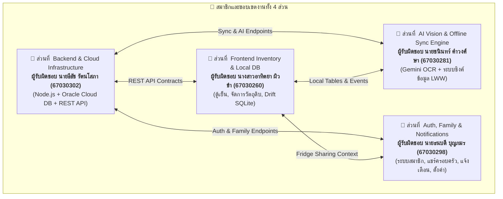
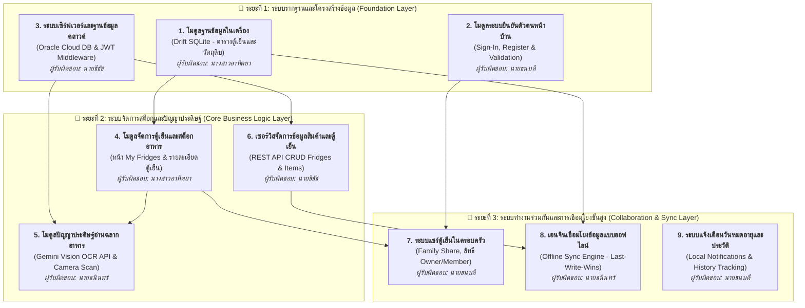

# 📋 แผนการแบ่งงานโครงงาน FM-EAA (Task Division & Responsibilities)

เอกสารฉบับนี้จัดทำขึ้นเพื่อใช้แบ่งงานและหน้าที่ความรับผิดชอบในการพัฒนาโปรเจกต์ **FM-EAA (Fridge Management & Expiry Alert App)** สำหรับสมาชิกในทีม 4 คน โดยระบุผู้รับผิดชอบหลักในแต่ละโมดูลอย่างชัดเจน เพื่อลดการเกิดโค้ดขัดแย้ง (Merge Conflicts) และสามารถพัฒนาควบคู่กันไปได้อย่างมีประสิทธิภาพ

---

## 🗺️ ภาพรวมการแบ่งงาน (Overview Matrix)

### ตารางสรุปหน้าที่และความรับผิดชอบ

| ส่วนที่ | ขอบเขตงาน (Module) | ผู้รับผิดชอบหลัก | รหัสนักศึกษา | หน้าที่หลักโดยสรุป |
| :---: | :--- | :--- | :---: | :--- |
| **1** | **Backend & Cloud Infrastructure** | **นายธีธัช รัตนโสภา** | 67030302 | Oracle Cloud DB (OCI), Database Migrations, REST API Core, JWT Auth และ Server Security |
| **2** | **Frontend Inventory & Local DB** | **นางสาวอาทิตยา ผิวขำ** | 67030260 | Drift SQLite, หน้ารายการตู้เย็น (My Fridges), หน้าสต็อกวัตถุดิบ (Fridge Detail), ฟอร์มสินค้า และ Consume Flow |
| **3** | **AI Vision & Offline Sync Engine** | **นายชนินทร์ คำวงศ์ษา** | 67030281 | สแกนฉลากด้วย Gemini Vision API, ตรวจสอบสถานะการเชื่อมต่อ และสร้างระบบ Auto-Sync (Last-Write-Wins) |
| **4** | **Auth, Family & Notifications** | **นายธนบดี บุญภมร** | 67030298 | ระบบ Login/Register/Google Sign-In, ระบบแชร์ตู้เย็นกับครอบครัว (Family Share), ประวัติ (History), ระบบแจ้งเตือน และหน้าตั้งค่า |

---

---

## 🚦 ลำดับขั้นตอนการพัฒนาและความสัมพันธ์ระหว่างโมดูล (Module Dependencies & Integration Roadmap)

> 💡 **หลักการพัฒนาและการเชื่อมต่อระบบ (Integration Principles):**
> 1. **พัฒนาจากโมดูลรากฐานขึ้นสู่โมดูลระดับบน (Foundation-First Architecture):** ระบบต้องมีฐานข้อมูล (Database) และโครงสร้างการยืนยันตัวตน (Authentication) ที่นิ่งก่อน จึงจะสามารถพัฒนาหน้าจอและฟังก์ชันธุรกิจ (Business Logic) ต่อยอดได้
> 2. **การรวมโค้ดแบบทีละขั้น (Incremental Integration):** เมื่อแต่ละโมดูลย่อยพัฒนาและผ่านการทดสอบ (Automated Tests) เรียบร้อยแล้ว จึงทำการรวมเข้าสู่กิ่งหลัก (`develop`) เพื่อป้องกันข้อขัดแย้งของโค้ด (Merge Conflicts)
> 3. **รักษามาตรฐานความเข้ากันได้ของข้อมูล (Data Contract Integrity):** โครงสร้างโมเดลและฟิลด์ข้อมูลใน Local DB (Drift) และ Cloud DB (Oracle) ต้องสอดคล้องกันทุกจุด

### 📊 ตารางลำดับการผสานระบบ (Module Integration Sequence)

| ลำดับ | โมดูลงาน (Module Component) | ผู้รับผิดชอบหลัก | ความสัมพันธ์กับระบบอื่น (Prerequisites) | ความสำคัญ |
| :---: | :--- | :---: | :--- | :---: |
| **1** | **ระบบฐานข้อมูลภายในเครื่อง (Local SQLite Database)** | นางสาวอาทิตยา | เป็นรากฐานของแอปทั้งหมด จัดเตรียมตาราง `FridgesTable`, `ItemsTable` | 🔴 **ชั้นรากฐาน (Foundation)** |
| **2** | **ระบบยืนยันตัวตนฝั่งผู้ใช้ (Client-Side Authentication)** | นายธนบดี | วางโครงสร้างฟอร์มเข้าสู่ระบบ, สมัครสมาชิก และการตรวจสอบความถูกต้องของข้อมูล | 🔴 **ชั้นรากฐาน (Foundation)** |
| **3** | **ระบบเซิร์ฟเวอร์และฐานข้อมูลกลาง (Cloud Database & Auth Core)** | นายธีธัช | ติดตั้ง Oracle Cloud DB, ตารางหลัก 7 ตาราง และ `authenticateToken` middleware | 🔴 **ชั้นรากฐาน (Foundation)** |
| **4** | **ระบบส่วนต่อประสานจัดการตู้เย็น (Fridge Management UI)** | นางสาวอาทิตยา | ต้องอาศัย Local DB (ลำดับ 1) เพื่อบันทึกและแสดงผลรายการตู้เย็นและของในตู้ | 🟡 **ฟังก์ชันหลัก (Core)** |
| **5** | **ระบบวิเคราะห์ฉลากอาหารด้วยปัญญาประดิษฐ์ (AI Vision OCR)** | นายชนินทร์ | อาศัย `authenticateToken` จากลำดับ 3 และส่งข้อมูลกลับไปยังแบบฟอร์มในลำดับ 4 | 🟡 **ฟังก์ชันหลัก (Core)** |
| **6** | **ระบบบริการข้อมูลวัตถุดิบบนคลาวด์ (Cloud Inventory Services)** | นายธีธัช | พัฒนา REST API รองรับการดึงและอัปเดตข้อมูลตู้เย็นและวัตถุดิบบน Oracle Cloud | 🟡 **ฟังก์ชันหลัก (Core)** |
| **7** | **ระบบแบ่งปันตู้เย็นกับครอบครัว (Family Sharing Module)** | นายธนบดี | อาศัยข้อมูลผู้ใช้ (ลำดับ 2) และข้อมูลตู้เย็น (ลำดับ 4) ในการจัดการสิทธิ์การเข้าถึง | 🟢 **ระบบขั้นสูง (Advanced)** |
| **8** | **ระบบประสานข้อมูลแบบออฟไลน์ (Offline-First Sync Engine)** | นายชนินทร์ | เชื่อมโยงข้อมูลระหว่าง Local DB (ลำดับ 1) กับ Cloud Services (ลำดับ 6) ด้วยหลัก LWW | 🟢 **ระบบขั้นสูง (Advanced)** |
| **9** | **ระบบแจ้งเตือนเตือนวันหมดอายุและประวัติ (Alerts & History)** | นายธนบดี | ดึงข้อมูลวันหมดอายุจากสต็อกอาหาร เพื่อตั้งเวลาแจ้งเตือนล่วงหน้าบนอุปกรณ์ | 🟢 **ระบบขั้นสูง (Advanced)** |

---

### 📋 ลำดับขั้นตอนการพัฒนาเจาะจงตามขอบเขตงาน (Role-Based Implementation Steps)

#### 👤 ส่วนที่ 1 นายธีธัช รัตนโสภา (Backend & Cloud DB)
- ⏳ **ขั้นที่ 1** กำหนดค่าการเชื่อมต่อ Oracle Cloud DB ใน `backend/src/config/db.js` และประมวลผลสคริปต์ `backend/src/db/migrations/001_init.sql` เพื่อสร้างตารางข้อมูลทั้ง 7 ตารางบนระบบคลาวด์
- ⏳ **ขั้นที่ 2** พัฒนาระบบยืนยันตัวตนใน `authService.js` และ `authRoutes.js` (Register, Login, Password Hashing ด้วย `bcrypt`, และการออก JWT Token)
- ⏳ **ขั้นที่ 3** จัดทำ `authenticateToken` ใน `middleware/auth.js` สำหรับตรวจสอบสิทธิ์การเข้าถึง API ทุกเส้นทาง
- ⏳ **ขั้นที่ 4** พัฒนา REST API และ Service จัดการตู้เย็นและสมาชิก (`fridgeRoutes.js`, `fridgeService.js`) รองรับ CRUD ตู้เย็นและการเช็คสิทธิ์ Owner/Member
- ⏳ **ขั้นที่ 5** พัฒนา REST API และ Service จัดการสต็อกวัตถุดิบและประวัติ (`itemRoutes.js`, `historyRoutes.js`)
- ⏳ **ขั้นที่ 6** พัฒนาชุดทดสอบอัตโนมัติ (Automated Tests) ด้วย Jest/Supertest ใน `backend/tests/` เพื่อทดสอบ Route, Auth, และ Error Handling

#### 👤 ส่วนที่ 2 นางสาวอาทิตยา ผิวขำ (Frontend Inventory & Local DB)
- ⏳ **ขั้นที่ 1** พัฒนาระบบฐานข้อมูล Drift SQLite ในเครื่อง (`app_database.dart`) ให้รองรับตาราง `FridgesTable` และ `ItemsTable` แบบออฟไลน์
- ⏳ **ขั้นที่ 2** พัฒนาหน้าจอแสดงรายการตู้เย็นและฟอร์มสร้าง/แก้ไขตู้เย็น (Screens #5–8: `MyFridgesPage`, `AddFridgePage`, `EditFridgeSheet`)
- ⏳ **ขั้นที่ 3** พัฒนาหน้ารายละเอียดวัตถุดิบภายในตู้เย็นและการกรอง (Screen #9: `FridgeDetailPage` แยกแท็บ Fridge/Freezer และชิปหมวดหมู่ พร้อมเชื่อมต่อ Local DB)
- ⏳ **ขั้นที่ 4** พัฒนาระบบค้นหาวัตถุดิบ (Screen #10: `SearchPage` ค้นหาแบบ Real-time พร้อมปุ่มล้างคำค้น)
- ⏳ **ขั้นที่ 5** พัฒนาแบบฟอร์มการบันทึกและแก้ไขวัตถุดิบ (Screens #11–13: `AddItemPage`, `EditItemPage`, `ItemDetailsPage`)
- ⏳ **ขั้นที่ 6** พัฒนาระบบบันทึกการบริโภคอาหาร (Screens #14–16: Mark as Consumed Sheet, Finished all, และ Undo SnackBar)

#### 👤 ส่วนที่ 3 นายชนินทร์ คำวงศ์ษา (AI Vision & Offline Sync Engine)
- ⏳ **ขั้นที่ 1** พัฒนาบริการวิเคราะห์ฉลากอาหารฝั่งเซิร์ฟเวอร์ (`aiService.js`, `aiRoutes.js`) เชื่อมต่อ Google Gemini Vision API สกัดชื่ออาหารและวันหมดอายุ
- ⏳ **ขั้นที่ 2** พัฒนาหน้าจอการสแกนฉลากด้วยกล้องบนมือถือ (`scan_label_page.dart`) และระบบนำผลลัพธ์มา Autofill ข้อมูลลงแบบฟอร์มวัตถุดิบ
- ⏳ **ขั้นที่ 3** พัฒนาระบบตรวจสอบสถานะการเชื่อมต่อเครือข่ายเบื้องหลัง (`connectivity_watcher.dart`) ด้วย `connectivity_plus`
- ⏳ **ขั้นที่ 4** พัฒนาระบบซิงค์ข้อมูลฝั่งเซิร์ฟเวอร์ (`syncRoutes.js`, `syncService.js`) รองรับ Last-Write-Wins (LWW) อิงตาม `updated_at`
- ⏳ **ขั้นที่ 5** พัฒนาระบบประมวลผลการซิงค์ฝั่งมือถือ (`sync_engine.dart`) รวมส่งข้อมูลแบบ Batched และจัดการสถานะ `is_synced`

#### 👤 ส่วนที่ 4 นายธนบดี บุญภมร (Auth, Family Sharing & Notifications)
- ✅ **ขั้นที่ 1** พัฒนาหน้าจอการพิสูจน์ตัวตน (Screens #1–4: `OnboardingPage`, `SignInPage`, `CreateAccountPage`, `ResetPasswordPage`) พร้อมระบบตรวจสอบความถูกต้องของข้อมูลนำเข้า (Form Validation & Loading State)
- ⏳ **ขั้นที่ 2** เชื่อมโยงระบบเข้าสู่ระบบฝั่งหน้าบ้านเข้ากับเซิร์ฟเวอร์หลักผ่าน `AuthRepository` และจัดเก็บ Session/Token ปลอดภัย (`flutter_secure_storage`)
- ⏳ **ขั้นที่ 3** พัฒนาระบบจัดการสมาชิกตู้เย็นและแชร์ครอบครัว (Screens #18–20: `FamilySharePage`, `InviteMemberPage`, `RemoveMemberDialog`)
- ⏳ **ขั้นที่ 4** พัฒนาระบบประวัติการใช้งานตู้เย็น (Screen #17: `HistoryPage` แยกแท็บ Consumed/Expired พร้อมปุ่มล้างประวัติเดี่ยวและ Clear All)
- ⏳ **ขั้นที่ 5** พัฒนาระบบแจ้งเตือนบนอุปกรณ์ (Screen #21: `NotificationsPage` และ Local Notifications เตือนของใกล้หมดอายุล่วงหน้า)
- ⏳ **ขั้นที่ 6** พัฒนาหน้าจอการตั้งค่าและโปรไฟล์ (Screens #22–24: `SettingsPage`, `EditProfilePage` รองรับการสลับธีม/ภาษา และการออกจากระบบ)

---

## 👤 ส่วนที่ 1 Backend, Cloud Database & API Core (ฝั่งเซิร์ฟเวอร์)
**ผู้รับผิดชอบ** นายธีธัช รัตนโสภา (67030302)

> **เป้าหมาย** สร้างและดูแลระบบเซิร์ฟเวอร์ Cloud Database, การพิสูจน์ตัวตน และ Business Logic ของ REST API ทั้งหมด

### 📁 ไฟล์และโฟลเดอร์ที่รับผิดชอบ
- `backend/src/config/` (`db.js`, `env.js`)
- `backend/src/db/migrations/001_init.sql`
- `backend/src/middleware/` (`auth.js`, `errorHandler.js`)
- `backend/src/routes/` (`authRoutes.js`, `fridgeRoutes.js`, `itemRoutes.js`, `historyRoutes.js`)
- `backend/src/services/` (`authService.js`, `fridgeService.js`, `itemService.js`)
- `backend/tests/`

### 📝 รายละเอียดงานที่ต้องทำ
1. **Oracle Cloud Infrastructure (OCI) & Database**
   - ติดตั้งและตั้งค่า Oracle Autonomous Database หรือ Connection Pool ผ่าน `oracledb` ใน `config/db.js`
   - รัน SQL Script สร้างตารางจริงทั้ง 7 ตารางจาก `001_init.sql` (users, fridges, fridge_members, fridge_invites, items, item_history, notifications)
2. **Authentication & Security**
   - พัฒนาระบบ Register / Login ด้วย Email/Username + Password (เข้ารหัสด้วย `bcrypt`)
   - พัฒนาระบบออกและตรวจสอบ JWT Token ใน `middleware/auth.js`
   - ตรวจสอบความถูกต้องของ Google ID Token สำหรับ Google Sign-In
   - พัฒนาระบบ Forgot Password (สร้าง Token รีเซ็ตส่งทาง Email)
3. **Core Business Logic Services**
   - พัฒนา CRUD สำหรับตู้เย็น (Fridges) ตรวจสอบสิทธิ์ Owner / Member
   - พัฒนา CRUD สำหรับวัตถุดิบ (Items) รองรับการแบ่งโซน Fridge / Freezer และหมวดหมู่
   - พัฒนาระบบบันทึกประวัติ (History) เมื่อมีการกิน (Consumed) หรือหมดอายุ (Expired)
4. **Backend Automated Testing**
   - เขียน Unit & Integration Tests ด้วย Jest / Supertest ให้ครอบคลุมทุก Endpoint และรักษา Code Coverage $\ge 70\%$

---

## 👤 ส่วนที่ 2 Frontend Inventory & Local Database (สต็อกวัตถุดิบและตู้เย็น)
**ผู้รับผิดชอบ** นางสาวอาทิตยา ผิวขำ (67030260)

> **เป้าหมาย** สร้าง UI สำหรับจัดการตู้เย็น สต็อกอาหาร การค้นหา และฐานข้อมูล SQLite ในเครื่องมือถือ

### 📁 ไฟล์และโฟลเดอร์ที่รับผิดชอบ
- `frontend/lib/features/fridges/` (หน้า My Fridges, เพิ่ม/แก้ไข/ลบตู้)
- `frontend/lib/features/fridge_detail/` (หน้ารายละเอียดตู้, แท็บ Fridge/Freezer, ชิปหมวดหมู่)
- `frontend/lib/features/item/` (หน้า Add/Edit/Detail, Mark as Consumed Sheet, Undo Snackbar)
- `frontend/lib/features/search/` (หน้าค้นหาวัตถุดิบ)
- `frontend/lib/data/local/` (`app_database.dart` - ส่วนตารางและ DAO ของ Fridges & Items)
- `frontend/lib/data/repositories/` (`fridge_repository.dart`, `item_repository.dart`)

### 📝 รายละเอียดงานที่ต้องทำ
1. **Local Database (Drift SQLite)**
   - พัฒนา DAO และ Query สำหรับตาราง `FridgesTable` และ `ItemsTable` ในเครื่อง
   - พัฒนาระบบ Optimistic UI (บันทึกข้อมูลลงเครื่องทันทีก่อน พร้อมตั้งสถานะ `is_synced = false`)
2. **หน้าจอจัดการตู้เย็น (Screens #5–8)**
   - หน้ารายการตู้เย็นแบบ Grid 2 คอลัมน์ (แสดงชื่อ, จำนวนของ, ป้าย Personal หรือ N members)
   - ฟอร์มสร้างตู้เย็นใหม่ และ Bottom Sheet แก้ไข/ลบตู้เย็น
3. **หน้ารายการวัตถุดิบและค้นหา (Screens #9–10)**
   - แสดงรายการอาหารแยกตามแท็บช่องธรรมดา (Fridge) และช่องแช่แข็ง (Freezer)
   - ป้ายสถานะความสด **Fresh** (เขียว), **Use soon** (ส้ม), **Expired** (แดง) พร้อมระบุจำนวนวันที่เหลือ
   - แถบวงกลมกรองหมวดหมู่ All, Proteins, Veggies, Beverages, Meals, Sauces
   - ระบบค้นหาวัตถุดิบตามคีย์เวิร์ดแบบ Real-time พร้อมปุ่มล้างคำค้น
4. **ฟอร์มวัตถุดิบและการกินของ (Screens #11–16)**
   - ฟอร์มเพิ่ม/แก้ไขวัตถุดิบ (Food Name, Category, Quantity, Unit, Storage Location, Expiry Date)
   - Flow **"Mark as Consumed"** Bottom Sheet เลือกลดจำนวนที่บริโภค หรือกด **"Finished all"**
   - แสดง Snackbar ยืนยันการกิน พร้อมปุ่ม **Undo** เพื่อย้อนสถานะกลับได้

---

## 👤 ส่วนที่ 3 AI Vision & Offline-First Sync Engine (ระบบ AI และการซิงค์ข้อมูล)
**ผู้รับผิดชอบ** นายชนินทร์ คำวงศ์ษา (67030281)

> **เป้าหมาย** พัฒนาระบบสแกนฉลากด้วย Gemini Vision API และเครื่องมือเชื่อมโยงข้อมูลระหว่างมือถือกับ Cloud Database

### 📁 ไฟล์และโฟลเดอร์ที่รับผิดชอบ
- `frontend/lib/features/item/presentation/pages/scan_label_page.dart`
- `frontend/lib/features/item/presentation/pages/barcode_scanner_page.dart`
- `frontend/lib/sync/` (`sync_engine.dart`, `connectivity_watcher.dart`)
- `backend/src/routes/aiRoutes.js`, `backend/src/services/aiService.js`
- `backend/src/routes/syncRoutes.js`, `backend/src/services/syncService.js`

### 📝 รายละเอียดงานที่ต้องทำ
1. **AI Vision Label Scanning (Gemini API)**
   - ฝั่ง Frontend เปิดกล้องหรือเลือกภาพฉลากอาหารจากคลังภาพ (`image_picker`) แสดงหน้าจอพรีวิว
   - ฝั่ง Backend รับรูปภาพ Base64/Multipart แล้วส่งต่อไปยัง **Google Gemini Vision API** ด้วย Prompt วิเคราะห์ฉลากอาหาร
   - สกัดข้อมูลสำคัญ **ชื่ออาหาร (Food Name)** และ **วันหมดอายุ (Expiry Date)**
   - ส่งผลลัพธ์กลับมายังมือถือ และ Auto-fill ข้อมูลลงในแบบฟอร์ม Add Item ให้อัตโนมัติ
2. **Connectivity Watcher**
   - ใช้ `connectivity_plus` ตรวจสอบสถานะการเชื่อมต่อเครือข่ายเบื้องหลัง
   - แจ้งเตือนเมื่ออุปกรณ์เปลี่ยนสถานะจาก Offline เป็น Online
3. **Batched Synchronization Engine**
   - ดึงรายการที่มีการเปลี่ยนแปลงในเครื่อง (`is_synced = false`) รวมส่งเป็น Batch ไปยัง `POST /api/sync`
   - ฝั่ง Backend บันทึกลง Oracle Cloud โดยใช้หลักการ **Last-Write-Wins (LWW)** อิงตามฟิลด์ `updated_at`
   - อัปเดตสถานะในเครื่องเป็น `is_synced = true` เมื่อซิงค์สำเร็จ
   - ปรับการซิงค์ให้ครอบคลุมขอบเขตรายตู้เย็น (Scoping by `fridge_id`) เพื่อรองรับการแชร์ตู้

---

## 👤 ส่วนที่ 4 Auth, Family Sharing, History & Notifications (ระบบสมาชิกและการแจ้งเตือน)
**ผู้รับผิดชอบ** นายธนบดี บุญภมร (67030298)

> **เป้าหมาย** ดูแลระบบสิทธิ์ผู้ใช้ การแชร์ตู้เย็นกับครอบครัว ประวัติการบริโภค และระบบแจ้งเตือนเตือนวันหมดอายุ

### 📁 ไฟล์และโฟลเดอร์ที่รับผิดชอบ
- `frontend/lib/features/auth/` (Onboarding, Sign In, Register, Forgot Password)
- `frontend/lib/features/family/` (Family Share, Invite Member, Remove Member)
- `frontend/lib/features/history/` (หน้าประวัติ Consumed & Expired)
- `frontend/lib/features/notifications/` (หน้ารายการแจ้งเตือน)
- `frontend/lib/features/settings/` (ตั้งค่า, โปรไฟล์, เปลี่ยนภาษา/ธีม)
- `frontend/lib/core/notifications/notification_service.dart`
- `backend/src/routes/userRoutes.js`, `notificationRoutes.js`

### 📝 รายละเอียดงานที่ต้องทำ
1. **Authentication Flow (Screens #1–4)**
   - หน้า Onboarding & Permission (แนะนำแอปและขอสิทธิ์การแจ้งเตือน)
   - หน้า Sign In / Create Account (พร้อมระบบ Validate รหัสผ่าน $\ge 8$ ตัวอักษร)
   - เชื่อมต่อ Google Sign-In SDK และหน้า Reset Password
2. **Family Sharing (Screens #18–20)**
   - แสดงรายชื่อสมาชิกในตู้เย็น พร้อมระบุบทบาท **Owner** หรือ **Member**
   - ค้นหาผู้ใช้ด้วย Username เพื่อส่งคำเชิญเข้าร่วมตู้เย็น
   - จัดการสิทธิ์การลบสมาชิกออกจากตู้ (เฉพาะ Owner)
3. **ระบบประวัติการใช้งาน (History - Screen #17)**
   - แยก 2 แท็บ 🍽️ **Consumed** (ของที่กินแล้ว) และ ⏰ **Expired** (ของที่หมดอายุ)
   - บันทึกชื่อผู้ทำรายการ (`@username`) และวันเวลาในแต่ละรายการ
   - ปุ่มลบรายการเดี่ยว และปุ่ม **Clear All**
   - พัฒนา Background Routine ลบประวัติเก่าอัตโนมัติเมื่อครบ 30 วัน
4. **ระบบแจ้งเตือน (Notifications - Screen #21)**
   - **Offline Local Notifications** ตั้งเวลาแจ้งเตือนล่วงหน้าเมื่อของใกล้หมดอายุบนเครื่อง (`flutter_local_notifications`)
   - **In-App Notifications** แสดงคำเชิญเข้าตู้ พร้อมปุ่มยอมรับ (**Accept**) หรือปฏิเสธ (**Decline**)
5. **การตั้งค่าและธีม (Settings - Screens #22–24)**
   - แก้ไขข้อมูลส่วนตัว (Name, Email, Profile Picture, เปลี่ยนรหัสผ่าน)
   - สลับภาษา **TH / EN** และสลับธีม **Light / Dark** (Material 3)
   - ไดอะล็อกยืนยันการออกจากระบบ (Log Out)

---

## 📌 สรุปการเชื่อมโยงกับโค้ด Skeleton ปัจจุบัน

- ทุกหน้าจอใน `frontend/lib/features/` มีคอมเมนต์ระบุ `// TODO(screen #...):` และจัดวาง Widget โครงสร้างไว้แล้ว
- รายละเอียดเลข Node ใน Figma และเส้นทาง Route สามารถเปิดเทียบได้จากเอกสาร [`docs/SCREENS.md`](SCREENS.md)
- ดีไซน์ โทเคนสี และข้อกำหนดทางเทคนิคทั้งหมด อ้างอิงจาก [`docs/DESIGN_SPEC.md`](DESIGN_SPEC.md)
